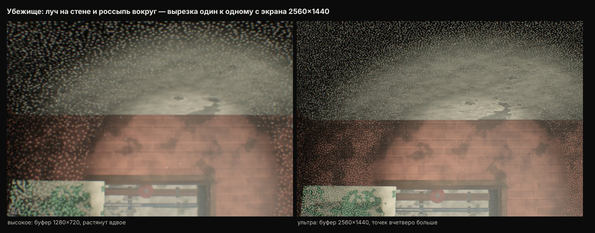

# Untitled Session — числа и устройство

Игра называется **Untitled Session** (папка пакета пока прежняя — `vylazka/`, прежнее название
«Вылазка»). Замысел — что это, чем объясняется простая графика, сюжет — в `untitled_session.md`.
Этот документ — числа и устройство: генератор, игрок, фонарь, рендер, сессия, скачки, рой, режиссёр
страха. Числа взяты из кода. Техническая сторона — `vylazka/README.md`.

## 1. Что это

Исследование от первого лица: игрок с одним фонарём ходит по убежищу, в которое вросли домашние
комнаты, и ищет вещи из воспоминаний. Картинка — запись на старом мониторе. Кнопки действия нет:
игрок ходит, смотрит и светит.

Решения партнёра:

| Вопрос | Решение |
|---|---|
| Язык | По умолчанию английский, русский включается в настройках |
| Цель | Сессия: пять воспоминаний, каждое — найти вещь и подержать её в луче |
| Угрозы | Осыпь, пугалки без урона, опасности среды, паника. Смерти нет: провал и газ выбрасывают в другое место, Осыпь возвращает в начало вылазки |
| Уровни | Полностью процедурные, по сиду |
| Платформа | ПК и телефон, под требования Playgama |
| Сеттинг | Восемь вылазок — части одной жизни (`sorties.md`). Сделаны три мира: убежище с вросшими домашними комнатами, офис и «жёлтые комнаты»; плюс карманные пространства |
| Сущность | Осыпь: то, что свет отпустил, — точки мест, с которых он ушёл. Под лучом застывает, в темноте течёт (в коде — рой, `swarm`) |
| Звук | Файлы, сгенерированные через ElevenLabs |

## 2. Состояние по этапам

| Этап | Что | Состояние |
|---|---|---|
| 0 | Каркас пакета, платформа, пауза, смоук | сделан, в силе |
| 1 | Технический срез: вид, фонарь, тряска, управление | сделан, в силе; частота кадров на телефоне не измерена |
| 2 | Набор деталей и генератор убежища | сделан; в генератор добавлены домашние комнаты |
| 3 | Цикл вылазки: цели, находки, батарейки, отчёт, сохранение незаконченной вылазки | заменён циклом Untitled Session (этап ниже); остались паника и опасности среды |
| 4 | Рой, режиссёр страха, аномалии | сделан, в силе; поимка роем теперь даёт скачок |
| 5 | Звук | звуковой слой готов; клипов нет; набор надо собирать заново под новый замысел |
| 6 | Площадка, публикация | отложено решением партнёра |
| — | Визуал: материалы, фактуры, запустение, дымка, надписи, реквизит | сделан, в силе |
| — | Untitled Session: ядро (сессия, скачки, вещи), пространства (белое нигде, луг, кукольный домик), вещи, особые помещения, кинескоп | сделано; звук — нет; проверка на телефоне — нет |
| — | Эхо (второй способ видеть) и призрак Осыпи из-за спины | сделано |
| — | Миры: офис и жёлтые комнаты, свет потолочных панелей по клеткам, готовые модели с itch.io | сделано (§14); план восьми вылазок — `sorties.md` |
| — | Смешанная графика: плоские вещи (картонки, проекции) и выставочные экраны с картинками | сделано (§6, «Плоские вещи»); заросли и сканы — нет (`modeling.md`) |
| — | Всё иллюзорно: чего коснулся игрок — растворяется; возвращается, когда свет погас и зажёгся | сделано (§6, «Иллюзорные вещи») |
| — | Жёлтые комнаты — тёмные и чистые; офис без фонаря, датчики теряют неподвижного; эхо только без фонаря и только на ходу | сделано (§6, §14) |

## 3. Объект: убежище

Сетка яруса — 16 × 16 клеток по 3 м. Перепад между ярусами — 4,5 м, потолок — 2,7 м.
Ранг объекта задаёт размер: ранг I — два яруса, ранги II и III — три.

В квоте помещения убежища чередуются с домашними комнатами, которые «вросли» в него (`QUOTAS` в
`gen/layout.ts`). Порядок в квоте — приоритет размещения.

| Ярус | Помещения убежища | Домашние комнаты |
|---|---|---|
| I | спальный отсек, пункт управления, медпункт, санузел, склад | гостиная, кухня, прихожая |
| II | ФВУ, дизельная, баки воды, щитовая, склад | спальня, ванная |
| III | архив, склад, спальный отсек, завалы ×2, санузел | детская, гостиная, кухня |

Типы домашних комнат: `kitchen`, `living`, `bedroom`, `bathroom`, `nursery`, `hallway` (`HOME_ROOMS`).

Вход — люк с лестницей (он же прежний выход), за ним шлюз с двумя гермодверями. Ярусы соединены прямым
маршем: 30 ступеней по 0,15 × 0,30 м на три клетки длины.

Как строится план (`vylazka/src/gen/layout.ts`):

1. Вход и шлюз у южного края первого яруса.
2. Хребет-коридор: случайное блуждание на 11–19 клеток, чаще прямо, чем с поворотом. Коридоры
   шириной в клетку и не соприкасаются боками — между ними всегда стена.
3. Три–пять ответвлений по 2–5 клеток.
4. Лестница вниз — подальше от входа; клетки марша резервируются на обоих ярусах.
5. Циклы замыкаются явно: пустая клетка между двумя коридорными, далёкими по коридору
   (от 6 до 40 клеток обхода). Цикл нужен, чтобы от преследования было куда уходить.
6. Помещения из квоты ставятся к коридору дверью; крупным с вероятностью 45 % пробивается
   вторая дверь к далёкой клетке коридора — ещё один цикл.
7. Ярус отбраковывается, если на нём меньше четырёх помещений или нет ни одного цикла;
   попытка перезапускается с зерном от `(seed, attempt)`.

Генератор считает только целочисленным ГСЧ: сохранение хранит сид и версию генератора
(`GEN_VERSION`) и обязано дать тот же уровень на другом устройстве. Среднее число перезапусков
на 500 сидах — 0,45, наибольшее — 5.

Помещения обставляются по «слотам» — участкам стен по 2,7 м (`vylazka/src/world/furnish.ts`):
предмет ставится спиной к стене, глубокие предметы не ставятся в клетках с дверью. У каждого
помещения свой ГСЧ от `(seed, id помещения)`: правка обстановки одной комнаты не сдвигает остальные.

Каждое помещение отдаёт игре:

- **места для вещей** (стол, полка, пол): на них игра кладёт мелочь сна и вещи воспоминаний;
- **приметы** (`landmarks`) — рация, карта, сейф, медицинский шкаф, нары, стеллажи, ФВУ, вентилятор,
  щит управления, дизель, бак, щитовая, архив, завал, раковины. Целями они больше не служат; остались
  в данных уровня и в отладочном API.

## 4. Игрок

| Параметр | Значение |
|---|---|
| Шаг / бег | 2,3 / 4,3 м/с |
| Радиус и рост | 0,3 м / 1,75 м |
| Перешагиваемая высота | 0,36 м |
| Камера | на груди, 1,42 м над полом |
| Фонарь | у пояса: 0,27 м правее и 0,42 м ниже камеры |
| Отставание камеры от луча | 0,13 с; луч уходит от центра кадра не дальше 23° по горизонтали и 15° по вертикали |

Игрок ведёт луч, а не камеру: камера догоняет. Прыжка нет.

Мышь на ПК захватывается по клику. Четверть секунды после захвата или его потери движение мыши
не считается: захватывая мышь, браузер переносит курсор и может прислать это как «движение» на
полэкрана. Событие сверяется по времени создания, а не обработки (при редких кадрах оно доходит
с опозданием), и захват замечается не только по событию о нём, но и по самому движению — оно
успевает вклиниться раньше. Величина движения не ограничена ничем: резкий рывок — это тряска.

Отказ браузера в захвате мыши бывает двух родов, и игра их различает:

| Случай | Признак | Что делает игра |
|---|---|---|
| Захват недоступен вовсе: игра встроена в iframe с песочницей без `allow-pointer-lock` | отказ пришёл, а захват ещё ни разу не удавался | луч ведётся мышью с зажатой кнопкой, подсказка говорит именно это; трясти фонарь можно и не зажимая кнопку |
| Отказ временный: Chrome около секунды после Esc отклоняет повторный захват | захват уже работал | пауза возвращается, следующее нажатие пробует снова; режим управления не меняется |

## 5. Фонарь

| Параметр | Значение |
|---|---|
| Заряд | садится (с 16.11, §22): полного хватает на ~12 мин света; севшая до нуля отлёживается (15 % за полминуты покоя); вспомненная вещь заряжает полностью |
| Средний интервал отказов в спокойных условиях | 104 с (было 80; ×1,3 с 16.11); чаще только на последней четверти заряда |
| Передышка после оживления | 18 с (было 14) |
| Первый отказ | принудительно на 40-й секунде, один раз за игру (обучение); `?fail=N` меняет |
| Сколько трясти | от 0,6 до 1,5 с энергичной тряски |
| Зарядка удержанием (телефон, с 17.11, §22) | палец на кнопке дольше 0,25 с: +35 % заряда в секунду (с нуля — меньше 3 с); свет — только на полном и не раньше 0,6 с зарядки; вспышка 1 с (луч ×2,6 → ×1); короткий тап — выключатель |

Вероятность отказа в секунду умножается: ×3 в сырости, ×2,5 в панике,
×7 рядом с роем. Перед отказом фонарь 0,5–1,4 с мерцает — это предупреждение. Вялая тряска помогает
непропорционально хуже энергичной. Тряска шумит: шум услышит рой. Оживление и щелчок фонаря бывают поводом для скачка (раздел 7).

Способы трясти: мышь из стороны в сторону (считаются развороты направления, медленный поворот
камеры тряской не считается), клавиша `F` («стукнуть ладонью»), акселерометр телефона (усиление, если датчик
доступен). Пальцем по кнопке фонаря на телефоне больше не трут: с 17.11 фонарь там заряжают удержанием (§22).

## 6. Картинка

Всё, что видно, сделано кодом при запуске: шары материалов, фактуры, карта запустения, надписи.
Готовых картинок в сборке нет. Образцы — `references.md`.

**Свет.** `ambient (альбедо × AO) + фонарь × matcap`. Луч: яркое пятно 7–13°, ореол до 25°, слабая
засветка до 52°; затухание `1 / (1 + 0,07·d²)`. Пятно неровное: разводы дешёвого отражателя
и тёмная точка в самой середине.

**Облако точек.** Мир собран из точек, как сцена 3D-скана (приём 3D Gaussian Splatting): на каждой
поверхности сидят мелкие мягкие точки-сплаты, и поверхность видна настолько, насколько её «замерил»
свет. В ярком пятне луча точек столько, что они сливаются, — там видна сама поверхность. В ореоле
точки стоят на своих местах плотной ровной россыпью. На краю луча их меньше, и они отходят от
поверхности. Куда свет не достаёт, нет ничего: мир существует, только пока на него светят.
В помещении, где фонарь не светит, остаётся одна красная сетка. В белом нигде, на лугу и в домике
«сканирует» рассеянный свет: вблизи поверхность собрана, с 4 до 15 м редеет.

Сцена собирается там, куда смотрит луч. «Внимание скана» — это луч, который чуть отстаёт от
настоящего (догоняет со скоростью 8 в секунду): поверхность под лучом собирается не мгновенно.

**Память света: без света место осыпается.** Среда рыхлая: её держит только свет. Место, с которого
свет ушёл (луч отвели или фонарь погас), не гаснет разом — оно ещё семь секунд держится в памяти
и всё это время разрушается:

- середина пятна, где поверхность была сплошной, крошится зёрнами и за полсекунды-секунду
  превращается в точки;
- точки стоят на своих местах, потом одна за другой отпускают поверхность, съезжают вниз, как песок
  со стены (каждая третья всплывает, как пыль), уходят от взгляда и гаснут. Первыми уходят те, что
  появились последними, поэтому, редея, россыпь остаётся ровной;
- цвет остывает: точка помнит оттенок места, каким оно было при свете, и тускнеет; середина луча
  помнится ярче его краёв;
- через семь секунд места нет. Свет вернулся — оно собирается заново.

Память хранится в кадре, а не в мире (`MEMORY_FRAG`): цвет места и «свежесть» от 1 до 0. Каждый кадр
она переносится на новое положение камеры — по глубине пикселя находится его точка в мире и её место
в прошлом кадре. Если там было что-то другое или это место было за кадром, памяти нет: то, от чего
отвернулись, забыто сразу. Свежесть убывает по игровому времени (на паузе стоит). Усиление камеры,
которое в темноте растёт, память не разгоняет: она только гаснет. Пока место освещено не слабее,
чем помнится, в памяти — его нынешний цвет (иначе под ровным светом офиса место навсегда
запоминало бы случайную вспышку); когда свет уходит, помнится самый яркий из виденных.

**Длинная выдержка: без фонаря кадр смазывается.** Когда фонарь не светит, камера «не закрывает
затвор» (`TRAIL_FRAG`): всё яркое в кадре оставляет след, который гаснет около полусекунды. Стоишь —
картинка просто тает; повернул голову или пошёл — пространство тянется полосами, как на снимке
с долгой выдержкой. При свете и в светлых пространствах (луг, домик, белое нигде) следа нет.
В помещении со стробоскопом это видно лучше всего: вспышка не обрывается в черноту, а тает.

**Темнота меняет детали.** Пока место растворено, собраться прежним оно не обязано. Через семь секунд
без света (когда место исчезло), а потом каждые девять секунд: мелкие вещи в 14 м от игрока меняются
местами и поворачиваются, крупные встают задом наперёд (место и преграда у них те же), комната
с двумя вариантами обстановки неподалёку меняет вариант. Вещи воспоминаний и то, что уже меняется
под взглядом, не трогаются; в карманных пространствах этого нет.

**Эхо: второй способ видеть.** Свет показывает место таким, какое оно есть; эхо показывает только,
что оно есть. От каждого шага игрока расходится волна (9 м/с — вдвое быстрее бега), от бега —
сильнее. Щелчок фонаря волну не пускает: эхо поднимают только шаги. Там, где фронт волны идёт по
стенам и полу, на мгновение
проступают кромки предметов, углы и линии равного расстояния от источника — тонкие холодные линии,
без цвета и подробностей, как чертёж. Шаг слышно на 8–15 м. **Пока фонарь светит, эха нет вовсе**
(решение партнёра: «иначе в нём нет смысла» — эхо это способ видеть без света): оно гаснет за
десятую секунды, как только луч загорелся, и возвращается за треть, когда он погас. В офисе, где
фонаря нет, эхо видно там, куда не достаёт свет панелей.
**И только на ходу** (решение партнёра: «только при выключенном и при движении»): остановился —
волны гаснут примерно за секунду, не успев разойтись; пошёл — проступают сразу. Это касается всех
волн, и тех, что идут от Осыпи.

Отсюда три состояния. Светишь — видишь всё, и свет держит Осыпь, но зовёт её издалека. Идёшь
в темноте — видишь место по шагам и её волны. Стоишь в темноте — не видишь ничего: о том, что она
рядом, говорят только срывы сигнала камеры, призрак из-за спины и гаснущие панели. Чтобы узнать,
где она, надо сделать шаг или зажечь свет.

Осыпь слышно: пока она ближе 24 м, от неё идут свои волны — тёплого цвета, чаще, когда она тянется
к игроку (раз в 0,9 с против 2,6 с у бродящей). Фронт приходит с её стороны, даже из-за спины.

Эхо — один полноэкранный проход по карте глубины готового кадра (`ECHO_FRAG`, до шести волн разом):
для пикселя находится его точка в мире и расстояние до источника каждой волны. Кромки берутся из
той же глубины: в буфере она линейна по 1/z, поэтому на плоскости её вторая разность равна нулю,
а на краю предмета и в углу стены — нет. Рисуется в свой слой (`echoRT`), который прибавляет
«камера»: длинная выдержка его не смазывает. Учёт волн — `systems/echo.ts`.

**Призрак из-за спины.** Когда Осыпь позади игрока (дальше 52° от оси взгляда) и ближе 16 м,
впереди проступает её призрак: то же тело, отражённое вперёд, как в зеркале, стоящем поперёк
взгляда. Он красный (цвет сетки — знак системы, а не вещь мира), разбит на строки, дрожит и виден
сквозь стены; если между игроком и Осыпью стена — вдвое бледнее. Повернулся к ней — призрака нет.
Приём взят из прототипа партнёра с обзором на 360°.

**Плоские вещи.** Не всё в игре имеет объём: часть вещей помнится снимком. Родов три
(`world/flat.ts`, `world/props_screens.ts`; зачем они — `untitled_session.md`, §2).

- *Картонка* — предмет мебели, который оказался листом. Собирается как обычно, а потом сплющивается
  на плоскость своей передней стороны центральной проекцией из точки на высоте глаз (1,42 м)
  в 3,2 м перед ним: каждая вершина едет по своему лучу, поэтому с этого места картинка не меняется
  вовсе, а сбоку видно, что это лист. От глубины остаётся 3 % — около двух сантиметров рельефа, чтобы
  ближнее по-прежнему заслоняло дальнее. Грани, повёрнутые от «объектива», в снимок не попадают.
  Картонка — вещество: материалы и нормали прежние, под фонарём она отсвечивает как объёмная. Но
  преграды у неё нет, тени нет, и с изнанки её нет вовсе.
- *Проекция* — комната, которой нет, поперёк прямого коридора: пол, потолок, боковые стены, дальняя
  стена в полосатых обоях и мебель у неё (стенка с телевизором, диван с ковром, кровать, кухня,
  кресло у телевизора, детская). Всё это «снято» с 4,4 м и сплющено в плоскость сечения коридора
  (2,7 × 2,7 м). Проекция — свет: цвет вершины уже готовая картинка (собственный цвет материала ×
  свет лампы спереди слева), точек на ней нет, тени она не отбрасывает. В темноте светится сама.
  **Свет её смывает**: при освещённости 0,012 картинка начинает выгорать зерном, при 0,11 пропадает —
  середина луча фонаря прожигает в ней дыру, сквозь которую видно, что коридор идёт дальше; свет
  потолочных панелей смывает её целиком. Смотрит в одну сторону: с изнанки её нет. Сквозь неё проходят.
- *Экран* — настоящая чёрная панель в тонкой рамке, которая светится картинкой: прислонённая к стене
  (1,14 × 2,08 м, наклон около 12°), стоящая на подставке или висящая на стене (лежачая, 1,7 × 0,98 м).
  Панель — вещество (рамка, изнанка, преграда), картинка — свет. Фонарь экран не смывает: на
  стекле остаётся блик; вблизи видны строки матрицы. Картинки — отдельный атлас 1920 × 1920 (клетка
  384 × 640): две клетки рисует код (настроечные полосы и «снег» — экран светится и без файлов),
  восемь — сгенерированные изображения из `assets/screens` (запросы — `screens.md`), девятая — кадр
  самой игры: луг с точки появления.
- *Экран-проём* — такой же экран, но на нём не картинка, а другое место игры: луг, каким его видишь,
  когда на нём оказываешься, — тропа к дверной раме. Стоять перед ним и смотреть можно сколько угодно.
  **Вошёл в него — кадр выбеливается, и ты на лугу** (скачок `cause: 'door'`, `whiteout`). Сам экран
  при этом рассыпается, как всё, чего коснулись, и после темноты встаёт снова — тем же проёмом.
  С луга выводит его дверная рама: ближе к искомой вещи, а если искать нечего — обратно к месту
  экрана. Если в миг входа идёт другой переход (первые секунды сессии, возврат из пространства), вход
  не теряется: проём ждёт конца перехода — но только пока игрок стоит в нём. В свободной прогулке
  без сессии проём никуда не уносит. Объект уровня — `display_door` (`world/screens.ts`: род `door`,
  `DOOR_IMAGE`, `DOOR_NAME`); сам собой этот кадр на экран не попадает — его ставит сборка уровня.

Где что стоит (решает сид уровня и место, а не ГСЧ помещения — остальная обстановка от этого не
сдвигается):

| | Убежище | Офис | Жёлтые комнаты |
|---|---|---|---|
| Картонки (доля мебели у стен, годной для этого) | 12 %: 0–4 на уровень | 4 %: 0–4 | 20 %, но мебели у стен там почти нет: 0–1 |
| Проекции | по одной на ярус ниже первого (две на уровень ранга II) | нет | до трёх на коридор, в прямых клетках без дверей |
| Экраны | нет | в приёмной всегда; в переговорной; телевизор в комнате отдыха; до трёх в коридорах (4–7) | **ровно два на уровень**: в ближнем к началу зале и в самом дальнем |
| Что на экранах | — | природа и странное: ею заменяют окна; на телевизоре в комнате отдыха — поп-культура | на ближнем — то же, что на экранах офиса (природа или странное): это один и тот же этаж; **дальний — проём**: на нём луг самой игры, и в него входят |

Плоским бывает лишь кое-что (решение партнёра: «плоским не должно быть всё, лишь некоторые объекты»),
а экраны — вещь офиса: в жёлтых комнатах их только два, «как соединение смысла и пространств», и в
темноте они — единственное, что светится само.

Проекции и картинки экранов лежат в отдельной сетке куска уровня (`LevelChunk.slides`) и рисуются
тем же шейдером мира с веткой `SLIDE`: без карты теней, без облака точек, без красной сетки. Где
стоят плоские вещи, знает список `BuiltLevel.flats` — по нему их находят проверки и отладка.
Цена невелика: свет — 400–800 треугольников на уровень, картинки экранов — 0,48 МБ в сборке
и одна текстура 1920 × 1920.

**Иллюзорные вещи.** Правило партнёра: «всё, к чему касается герой, растворяется в пространстве.
Появляется после, если выключить и включить фонарь, но уже может в другом виде или в другом месте.
Все объекты сна-воспоминаний иллюзорны». Оно заменяет и взаимодействие с предметами, и физику: вещь
нельзя ни взять, ни сдвинуть — можно только убедиться, что её нет.

- *Что растворяется.* Вся обстановка: мебель, вещи сна, картонки, экраны, сорванные створки, коврики
  и бумаги под ногами, картины на стене, если задеть их плечом. Не растворяется само место: стены,
  пол, потолок, колонны, лестницы, трубы — и две приметы, по которым его узнают: порог в проёме и
  двери лифта. Потолочного не достать, поэтому оно объектом не считается.
- *Как.* Игрок упирается в предмет — тот рассыпается за 0,9 с **точками**: поверхность распадается
  на зёрна, зёрна отходят от поверхности и гаснут в воздухе, на пол ничего не оседает (`decay.md`, §5). Первые 0,35 с он ещё
  держит (иначе игрок оказывался внутри раньше, чем успевал что-то заметить), потом пропускает. То,
  что на нём лежало, рассыпается вместе с ним. Предмет без преграды (картонка, коврик) чувствует
  касание по своим габаритам.
- *Когда возвращается.* Только после темноты: свет на месте вещи должен погаснуть и зажечься снова.
  В убежище и жёлтых комнатах это фонарь — выключить и включить (заглох и ожил — тоже считается);
  в офисе — панель над вещью: замер, датчики потеряли, пошевелился. Пока игрок стоит на её месте,
  вещь не возвращается.
- *Какой возвращается.* Всегда на ступень хуже: настоящая → картонка → проекция → кружево → нет
  (`decay.md`, §5). Ступень не обязана подходить вещи: настенная минует картонку, стоящая посреди
  пола — проекцию. Около четверти возвратов — ещё и на другое свободное место: участок стены
  в том же помещении. Случайности по-прежнему нет: решают сид уровня, номер предмета и счёт его
  возвращений. Прежнее правило «та же, другой предмет или в другом месте» отменено. С кружева вещь
  не возвращается совсем. Собой и на своё место возвращаются всегда: вещь воспоминания (её ищут по
  строке; пока её нет, вспомнить её нельзя), экран и экран-проём, берёза; гора не растворяется вовсе.
- *Как устроено.* Мебель лежит в общей сетке помещения — один вызов отрисовки на комнату, как и
  раньше. У каждой вершины есть номер объекта (`MeshData.obj`, `world/objects.ts`), у рендера —
  текстура состояний 64 × 64, четыре байта на объект: насколько он растворён, кружево ли он,
  насколько выцвел и насколько светится сам (последние два — для бумажных цветов). Шейдер мира
  находит точки объекта по номеру и убирает его поверхность зёрнами по два сантиметра: каждое
  сжимается в точку в свой срок. На том же месте рендер сеет облако точек цвета предмета, и оно
  растворяется в воздухе: точка отходит от поверхности на 4–16 см, мельчает и гаснет за полсекунды
  пути (`render/grains.ts`, шейдер `GRAIN_VERT`). Красная сетка и тень читают то же
  состояние: у растворённого предмета нет ни сетки, ни тени. Преграды знают
  хозяина (`Aabb.owner`) и выключаются вместе с ним; контроллер игрока сообщает, чего он коснулся.
  Автомат «стоит → растворяется → нет → собирается» — `systems/illusions.ts`; вещь, вернувшаяся
  на другой ступени или в другом месте, становится отдельной вещью сна. Красной сетки у тронутых
  вещей больше нет: красное осталось знаком системы (распад всего места, взгляд, под которым вещь
  меняется). Сборка — тот же путь назад: точки проступают из ничего у поверхности и встают на места.
  Кружево — не только сетка по граням: по изломам и краям вещи идут нити — линии тех же рёбер, что у
  красной сетки (`edgeIndex`), нарисованные шейдером мира (`LACE_EDGE`) тем же светом, сборкой и памятью,
  что сама вещь. У предмета помещения нити строятся раз, когда он становится кружевом (`laceEdges` куска),
  у вещи сна — когда она возвращается кружевом. Так кружевной диван читается диваном, а не ромбами.

На уровне 75–180 объектов в убежище, 80–115 в офисе, 15–30 в жёлтых комнатах (предел — 4095).

Лестница порчи и связь с Осыпью (тронутое растит её) сделаны — `decay.md`, §5, и раздел 15 ниже.
Чего пока нет: замены укрытиям — за шкафом не спрячешься; завал (§15) пока не служит преградой для
Осыпи (`plan.md`, §4).

Как это устроено:

- **Проходы.** (1) Мир рисуется сплошным в `sceneRT`: цвет и, в альфе, «число замеров» `h` —
  `освещённость × 24`, не больше 3,5. (2) Память света (`memRT`): что было освещено и как давно.
  (3) Сведение: поверхность показана там, где `h` велико (от 22 до 85 % предела — плавно) или где
  она только что была яркой и ещё крошится; остальное залито цветом дали (в убежище чёрным, в белом
  нигде белым). (4) Поверх рисуются точки — `THREE.Points`, без теста глубины, с мягким смешением.
  (5) Осыпь и её призрак — теми же точками. (6) Длинная выдержка — в `compRT`. (7) Эхо — в свой
  слой `echoRT`. (8) Дымка, отсвет и пост-обработка читают `compRT` и прибавляют слой эха.
- **Всё считает видеокарта.** Точка — вершина. В вершинном шейдере (`SPLAT_VERT`) она берёт из
  готового кадра цвет и число замеров места, где сидит, и сама решает, видна ли она, где стоит и
  какого размера. Процессор точки не двигает.
- **Два состояния точки.** «Дом» — место на поверхности; «разлёт» — отход вдоль нормали на 1,5–10 см,
  случайный сдвиг и медленное кружение. Между ними — `a = smoothstep(0,02; 0,5; h) × внимание скана`.
  По дороге точка отлетает дальше и возвращается: собирающаяся стена на миг вспухает россыпью.
  Точку, которой свет уже не достаётся, держит на месте память — пока не выйдет её срок.
- **Форма.** Мягкий гауссов диск, лежащий на поверхности: сбоку он виден эллипсом, как сплат в 3DGS.
  Размер в мире постоянный — `0,7 / √плотность` м (2–4 см), поэтому вблизи точка крупнее; на экране
  она не меньше 1,6 пикселя и не больше 1,3 % высоты кадра. Точка в разлёте мельче и круглая.
- **Цвет.** Цвет места под точкой, но не темнее отметки: на краю луча поверхность освещена слабо,
  а точка должна читаться. Без света — оттенок из памяти, остывающий к холодному.
- **Сквозь стены точек не видно:** точка сверяет своё расстояние с глубиной кадра.
- **Посев** (`world/points.ts`). Точки ложатся «синим шумом»: соседи держат дистанцию, но рядов и
  клеток нет. Случайный посев давал сгустки и дыры (читалось как шум), решётка — заметные ряды.
  Синий шум берётся из плитки в 4096 точек (каждая следующая встаёт в самое свободное место);
  плитка замощает плоскость стены в мировых координатах, поэтому рисунок точек на стене один и не
  зависит от того, из каких треугольников она собрана. Номер точки в плитке — её «очередь»: любая
  доля плотности — это начало плитки, то есть тоже ровное покрытие.
- **Плотность.** 300, 600 и 1100 точек на м² (низкое, среднее, высокое качество); на ступени «ультра»
  — до 4400: точка вдвое мельче, точек вчетверо больше, покрытие то же. В карманных
  пространствах — вшестеро реже. До 3,5 м стоят все точки, дальше редеют как квадрат расстояния
  (на экране их столько же), к 28 м гаснут совсем.
- **Клетки** (`render/splats.ts`). Облако помещения поделено на клетки до 6 м (в карманных
  пространствах — до 15 м), очередь точек — на 8 слоёв. Сколько слоёв рисовать, решается по
  расстоянию до клетки; клетка за кадром или дальше 28 м не рисуется. Досев идёт понемногу —
  `45 × плотность` точек за кадр (первый кадр после скачка — вшестеро больше): сначала первый слой
  всем клеткам рядом, потом слой за слоем ближним; сеется и то, что за спиной. Память возвращается:
  клетка, от которой отошли, через 600 кадров (10 секунд) ужимается до двух слоёв, сетка вне
  видимости отдаёт клетки целиком. У вещи, которая под взглядом выросла, посев уплотняется: точек на
  её поверхности в мире столько же, сколько у стен.

Цена. В убежище видеокарта получает за кадр 0,45–1,1 млн точек на высоком качестве и 0,13–0,3 млн
на низком; около половины из них шейдер показывает, остальные отбрасывает первой же проверкой
(без клеток точек было до 2,5 млн, а показывалась треть). Вызовов отрисовки от облаков — 20–60. Память света и длинная выдержка — ещё два полноэкранных
прохода и четыре буфера размером с кадр.
На программном рендере проход точек добавляет к кадру 7–20 % на высоком качестве и 20–45 % на низком. Посев — около 14 тысяч точек в миллисекунду на настольном процессоре; плитка синего шума
собирается один раз при загрузке (около 70 мс). **Частота кадров на телефоне не измерена.**
Отладка: `__vz.scan(false)` рисует мир сплошным — для сравнения кадров; `__vz.info()` — сколько
точек отдано (`points`), у скольких сеток есть облака (`clouds`), сколько клеток живо (`cells`);
`__vz.cloudUsage()` — сколько из отданных точек видно.

**Реализм поверх точек.** Стиль тот же — облако точек, запись с камеры, — но свет и «прибор» ведут
себя как настоящие:

- *Бумага возвращает луч лучше всего.* Плакат и лист на столе «сканируются» в 1,8 раза плотнее стены
  вокруг: печать читается раньше, чем проступает сама стена, и точки не съедают текст.
- *Сканер видит не всё одинаково.* Точек меньше там, откуда луч не возвращается: на поверхности,
  по которой взгляд скользит (до ×0,6), на стекле (×0,35 — луч уходит насквозь), на чёрной резине
  и бакелите (×0,6 — луч гаснет), на мокром бетоне (×0,78 — луч отражается прочь).
- *Кромки крошатся.* На границе предмета и фона настоящий скан даёт «летающие» точки. Здесь их дают
  сами точки: у кромки они отходят от поверхности и выступают за силуэт предмета.
- *Отсвет цветной.* Свет, отражённый зелёной стеной, зеленит всё вокруг: средний цвет освещённого
  пятна берётся из прошлого кадра (буфер 2×2, `spotRT`, `uSpot`) и окрашивает отсвет на 80 %.
- *Рассеянный свет идёт сверху:* `uAmbient × (0,66 + 0,34 × вверх)` — потолки и низ предметов темнее.
- *Прямой свет и его тени.* В пространствах с `Env.key` (солнце на лугу, лампа у кукольного домика)
  освещённая сторона плотнее и ярче теневой, а предметы отбрасывают тени. Карта теней одна: в убежище
  в ней тень фонаря, здесь — тень прямого света (`uShadowFor`), камера тени ортографическая и смотрит
  вдоль лучей. Квадрат теней со стороной `2 × key.reach` ходит за игроком шагами в один тексель карты
  (иначе края теней ползли бы) и сдвинут вперёд по взгляду на 0,35 × `reach`; к краю квадрата тень
  сходит на нет. На лугу `reach` 9 м (тексель 3,5 см на среднем качестве, 1,8 см на высоком), в домике
  7 м. Светящееся (купол неба, абажуры, обводка выхода) теней не отбрасывает. Дымки в луче в таких
  пространствах нет: карта теней занята. На низком качестве теней нет вовсе.
- *Домашние поверхности* (материалы 32–36): обои с рисунком, паркет «ёлочкой», линолеум,
  полированная плита, обивка — в жилых комнатах вместо голого бетона.

**Материал** — это три вещи:

1. *Matcap-шар*: как материал блестит под фонарём. 40 материалов в атласе 8×5 (шейдер держит до 48);
   последние три — офисные: светильник, ковролин, потолочная плита. Шар считается
   по модели настоящего материала под соосным светом: матовая часть, блик GGX (у металла окрашен,
   у шлифованного растянут), лаковый слой с острым белым бликом, ворс, пятнистость патины.
2. *Фактура*: слой из стопки тайловых текстур (17 слоёв 256×256) — высота, пестрота цвета,
   гладкость. Бетон в следах опалубки с гнёздами стяжек, побелка, масляная краска, ржавчина,
   металл в царапинах, дерево, ткань, кафель, стяжка пола, кирпич, обмотка труб, оцинковка…
   Высота наклоняет нормаль (без касательных в вершинах, по экранным производным), а с ней —
   выборку из шара: под лучом, идущим вскользь, видна каждая пора.
3. *Род запустения*: как материал стареет.

| Род | Материалы | Что происходит |
|---|---|---|
| краска | зелёная, синяя, охра по стенам | трескается на чешуйки и облезает ими до штукатурки; у кромки чешуйки загнуты, между ними тёмные трещины |
| металл | сталь, оцинковка, крашеное железо, чугун | ржавеет от швов и углов, вокруг — рыжие разводы |
| минерал | бетон, пол, кирпич, побелка | сыреет пятнами и темнеет; побелка облезает до бетона; белёсые высолы по границе сырости; у стен на полу — осыпавшиеся чешуйки |
| органика | дерево, ткань, бумага, картон, кожзам | темнеет от сырости |
| глянец | эмаль, кафель, стекло, бакелит, резина | только плёнка грязи |

Поверх любого рода: плесень в углах и под потолком, потёки по стенам, пыль на всём, что выше
пола и смотрит вверх. Сила запустения растёт с глубиной: у входа 25 %, на нижнем ярусе 85 %.
Где именно пятно, решает одна карта запустения (грязь, крупные пятна, потёки, сетка трещин),
привязанная к миру: стена выглядит одинаково, с какой стороны к ней ни подойти.

**Надписи** — один атлас 2048×2048. Трафареты с перемычками, надписи от руки, таблички, шкалы,
часы и календарь рисуются на canvas при запуске. Надписи русские на любом языке интерфейса. Трафарет —
прозрачный лист с буквами, цвет краски задаёт вершина.

**Карточка от руки** — *PLEASE USE ONLY WHEN NECESSARY*: одна на уровень, в каждом мире. Картонка
с ладонь (32 × 21 см): карандашная разлиновка, печатные буквы синим маркером. Букв в шрифте нет — у
карточки свой «почерк», набор штрихов (`world/signs.ts`, `HAND`): печатные буквы маркером не спутать
с типографскими. Висит на высоте глаз в помещении, следующем за началом вылазки (тамбур убежища,
приёмная офиса и жёлтых комнат), на свободном участке стены, ближайшем к началу, — не там, куда
возвращает Осыпь: перечитанная в пятый раз, она стала бы укором. Место под ней числится занятым:
вещь, вернувшаяся после темноты «у другой стены», карточку не закроет. Читается с метра; с двух видна
как карточка. По-английски на любом языке игры: это не надпись места, а голос самой сессии. Что именно
«использовать», она не говорит. Где висит, знает `BuiltLevel.notes`.

**Плакаты — настоящие листы.** Девять плакатов гражданской обороны и план убежища — не рисунки кодом,
а картинки (`vylazka/assets/posters/<id>.webp`, 512×768; откуда они и как их пересоздать —
`docs/vylazka/posters.md`). Сборка кладёт их отдельными файлами; игра стартует, не дожидаясь их, грузит
листы (`render/poster_images.ts`) и перерисовывает атлас: каждый лист вклеивается в свою клетку
400×600 и старится — сгибы, пожелтевшие края, бурые пятна, ржавчина от кнопок. Пока файл не пришёл,
на стене пустой лист. На стене плакат шириной 55–62 см, как настоящий лист 60×90; на рейках в помещениях
висят только такие листы. Где они висят, уровень запоминает (`BuiltLevel.sheets`).
`scripts/check_dist.mjs` не пропустит сборку, в которой потерялся файл листа.

**Дымка.** Свет фонаря, рассеянный сырым воздухом: проход вдоль взгляда от камеры до стены
в уменьшенном буфере. Луч виден конусом, воздух клубится и медленно ползёт. Плотность растёт
с глубиной и в газу — в восемь раз. На высоком качестве предметы режут дымку тенями.

**Камера.** Бочкообразная дисторсия, слабая хроматическая аберрация (сильная растягивала бы каждую
точку мира в радужный штрих), усиление сенсора с зерном (от 0,8
у близкой стены до 2,1 при взгляде вдаль; с погасшим фонарём — до 5,5), мягкий пересвет, виньетка,
ореол яркого пятна на грязном объективе, цвет записи: тени в болотную зелень, света в желтизну.

**Качество.**

| | Буфер | Тень | Рельеф и вторая карта | Дымка |
|---|---|---|---|---|
| низкое | 640×360 | нет | нет (краска всё равно облезает, металл ржавеет) | нет, вместо неё — свечение вокруг пятна |
| среднее | 960×540 | 512 | да | 8 шагов, буфер втрое меньше кадра |
| высокое | 1280×720 | 1024 | да | 14 шагов с тенями, буфер вдвое меньше |
| ультра | до 2560×1440, но не больше экрана | 2048 | да | как у высокого: дымка мельче не становится |

**Ультра — высокое качество вдвое мельче** (слова партнёра: «на десктопе при хорошем железе на уровне
hight нужно сделать зерно в 2 раза меньше, как и все растворяемые частицы. Условно, поднять визуал в
2 раза»). Устроено одним правилом: всё, что считается в точках, остаётся того же размера в пикселях
буфера, а буфер вдвое больше по стороне. Поэтому на экране вдвое мельче шум сенсора, точки, из которых
собрано место, пыль распавшихся вещей, Осыпь и пыль в луче; чтобы поверхность была покрыта так же,
точек вчетверо больше. А то, что принадлежит формату записи, — строки развёртки, маска кинескопа, блоки
срыва сигнала, разлёт цветов по краям, ореол — на экране остаётся прежним: иначе на большом экране
запись перестала бы читаться как запись. Мельче пикселя экрана зерна не бывает: на экране 1920 × 1080
выходит в полтора раза, вдвое — от 2560 × 1440 (`render/renderer.ts`, `fineOf`).

*Убежище, экран 2560 × 1440, вырезка один к одному: слева высокое качество (буфер 1280 × 720 растянут
вдвое), справа «ультра» — точек вчетверо больше, каждая вдвое мельче; строки записи те же.*

Ступень получает только сильный компьютер, и это измеряется, а не угадывается по названию видеокарты:
под заставкой загрузки игра рисует несколько кадров и каждый раз ждёт видеокарту (`App.probeFine`).
Если кадр обычного высокого качества занимает больше 5 мс или кадр мелкого — больше 11 мс, остаётся
обычное высокое; перед вторым замером игра ждёт, пока досеются точки (не дольше 0,7 с). В игре ступень держится строже остальных: 2,5 с подряд меньше 45 кадров в секунду —
и качество само возвращается на высокое. На телефоне ступени нет; в кнопке качества на компьютере она
четвёртая — там, где экран даёт зерно мельче хотя бы на четверть. Пороги выбраны расчётом: на настоящих видеокартах они не проверены.

Чужой ярус рисуется только с лестницы и в 16 м от её площадок; дальше 30 м чанки не рисуются.

**Обстановка.** Помещение обставляется в два прохода. Первый — то, что положено ему
по назначению (нары, дизель, фильтры, приметы). Второй — следы людей и времени: свободные
участки стен получают предметы по роду помещения, стены — трафареты, таблички и плакаты, потолок —
провисшие кабели и натёки, пол — бумаги. У каждой двери трафарет с названием помещения. В прямых
коридорах через клетку поперёк идёт потолочный ригель. Предметов убежища во втором проходе — 51 (реестр
`PROPS`; домашний реквизит — `HOME_PROPS` в `props_home.ts`, оба вместе — `ALL_PROPS`): от гермодвери и колонки фильтров до груды противогазов и рассыпанных бумаг. Предмет
выбирается из тех, что влезают на участок стены: в коридоре — только неглубокое. Приметы
обстановка не заслоняет: на старом генераторе это проверено на 500 уровнях (9270 примет), тест
на 30 сидах следит за этим дальше. Чем глубже ярус, тем больше хлама; надписи
от руки появляются только ниже первого яруса. Шахта лестницы остаётся голой — на этом стоит
аномалия длинной лестницы.

**Окружение пространств.** У каждого места свой `Env` (`world/pockets.ts`): рассеянный свет, цвет
дали (он же фон кадра), плотность тумана, множитель света фонаря, запущенность и плотность взвеси.
В убежище рассеянного света почти нет и даль чёрная; в других пространствах так:

| Пространство | Рассеянный свет | Цвет дали | Туман, 1/м | Фонарь × | Взвесь |
|---|---|---|---|---|---|
| убежище | 0,0016 / 0,0019 / 0,0024 | чёрный | 0,035 | 1 | 0,008 |
| белое нигде (и лимбо) | 0,62 (серый) | светло-серый, 0,86 | 0,06 | 0,12 | 0 |
| луг | 0,25 / 0,32 / 0,41 (небо) + солнце 0,96 / 0,88 / 0,66 | голубой, 0,28 / 0,46 / 0,8 | 0,006 | 0,1 | 0 |
| кукольный домик | 0,24 / 0,22 / 0,2 + лампа 0,52 / 0,4 / 0,23 | почти чёрный | 0,02 | 0,7 | 0,004 |

Кроме рассеянного света, у `Env` есть два необязательных поля. `key` — прямой свет пространства
(направление на источник, цвет с силой и `reach` — полуширина квадрата теней вокруг игрока): солнце
на лугу, большая лампа у кукольного домика; без него светит только рассеянный свет и фонарь. `scan` — дальность «сканирования» рассеянным светом:
до первого расстояния точки стоят плотно, ко второму редеют до россыпи; по умолчанию 4 и 15 м
(тесные пространства), на лугу даль видна дольше — до 40 м. Приложение считает пространство светлым
(фонарь не нужен, о заглохшем фонаре молчим), когда среднее рассеянного света плюс шестая часть суммы
прямого больше 0,3.

Запущенность и взвесь убежища игра считает по глубине сама. Уходящее место растворяется в цвет дали
того места, куда ведёт скачок.

**Распад геометрии.** Мир целиком или одна вещь рассыпается: вершинный шейдер разносит кусочки
в стороны и вверх, фрагментный выбивает в поверхности дыры (`uDissolve`, `uThing`). Так рассыпаются
место при скачке и вещь под взглядом.

**Красная сетка.** Отдельный проход рисует рёбра геометрии красным (`uWireColor`, `uWireAlpha`) с
пульсацией и затуханием с расстоянием. В полной темноте сетка 0,85, в помещении «сетка» — 0,5;
у искомой вещи она проступает при погашенном фонаре.

При входе в помещение с красной сеткой игроку говорят, что это (партнёр 17.11: «при входе в помещение с красной сеткой,
нужно что-то говорить игроку»), — раз за сон на каждый вид помещения, строкой посередине (`DreamEvent` `room`, ключи
`toast.room.*`): в тёмном — «…свет здесь не сохранился. только линии.», в «сеточном» — «…здесь разошлись швы. не стой
на месте.». Строки — голосом сна, как «…снова там, где начал.». Раз за сон, а не за помещение: во сне из сцен уровень новый
каждую минуту, и строка звучала бы в каждой сцене.

**«Сеточное» помещение опасно, если в нём стоять** (квиз 17.11, ночь: «Опасно, если стоять»). Простоял в нём 3,5 с
(медленнее 0,4 м/с; `WIRE_STILL`) — пол начинает расходиться, как при провале давления (`pressure.md`, §2): красная сетка по
полу, фронт от дальнего угла, не успел — упал и проснулся в начале. Идущему ничего не грозит; в спокойном режиме правила нет.
Так у красной сетки остаётся одно значение для света: «иди» (куратор, пачка 40, 228: строка без угрозы там, где опасности
нет, учила бы не верить знаку давления — теперь опасность есть). Такие помещения — отдельный список (`Game.wireRooms`), в
давление режиссёра они не входят: пол там уходит только от стояния.

**Вещи** — отдельные сетки (`world/thing_mesh.ts`), каждая со своей судьбой под взглядом
(`systems/things.ts`, `DEFAULT_THINGS`):

| Параметр | Значение |
|---|---|
| Дальность взгляда | 7 м |
| Сколько смотреть, чтобы вещь начала меняться | 2,4 с |
| Уменьшение / рассыпание / рост | 1,1 с / 1,5 с / 2,6 с |
| Во сколько раз вырастает | ×7 |

Судьба: `shrink` (уменьшается), `dust` (рассыпается), `grow` (вырастает и остаётся), `jump` (вырастает
и накрывает игрока — скачок). Взгляд засчитывается, если вещь в луче (допуск растёт с её угловым
размером), ближе дальности, ничем не заслонена и фонарь светит не слабее 0,3. Мелочь на столах и полках
(кружка, тапочки, мяч…) — `shrink`, `dust`, `grow`; крупное посреди коридоров (телевизор, фикус,
ёлка, кроватка, куча игрушек) — ещё и `jump` в соответствующее пространство (`BIG_THINGS` в `game.ts`).

**Манекены людей.** Деревянный манекен художника в рост человека из кода (`world/props_people.ts`):
голова-яйцо без лица, суставы — шары, светлый бук; поза — углы суставов, скелет — прямая кинематика от
таза; девять поз-заготовок. В местах его нет: фигуры расставляет партнёр сам и ему нужны другие фигуры
(его слова 16.11: «Не расставляй фигуры, я сам это сделаю. Тем более мне нужны другие фигуры. В следующий
раз спрашивай»). Манекен — вещь реестра: опросник (вкладка «Люди») и картинки материалов.

**Фигуры партнёра.** Фигуры ставит партнёр сам — с 17.11 в «Конструкторе» (`tools/constructor/`, вырос из
инструмента «Фигуры»; там же ставятся и вещи — см. ниже «Вещи партнёра»): гнёт манекен
руками, выбирает материал и правило места — в каких местах и помещениях, у чего (угол, стена, середина,
проём, под потолком), лицом куда (в стену, в комнату, на дверь, туда, откуда придёт игрок), на какой высоте
и сколько. Сохранённое основная модель переносит в список игры (`world/figures_data.ts`; пока пуст — партнёр
ещё ни одной не сохранил). Правило, а не точка: план места строится из сида, и сборка уровня ищет края
правила в настоящих помещениях (`world/figure_place.ts`): угол — 0,38 м от обеих стен, стена — 0,3 м, проём —
на линии стены, середина — середина клетки спиной к ближайшему проходу; сдвиг партнёра поворачивается вместе
с краем; фигура не врастает в мебель и стены (проверяются точки скелета), не стоит у самого начала и не
вплотную к другой; тот же сид — те же места. В игре фигура — вещь рендера, как всё (`world/figure_mesh.ts`):
облако точек следует за ней, распад идёт пылью. Как ведут себя (слова партнёра; `systems/figures.ts`):
дымная — бледная, из редких точек, медленно ходит вверх-вниз; подошёл ближе 2,3 м — рассеивается за полторы
секунды, отошёл дальше 6 м — через семь секунд собирается снова. Волосатая — ворс слоями, как мох; ближе
1,3 м — растворяется «от рук к телу»: кисти, предплечья, плечи, ступни, голени, бёдра, тело, голова последней
(около трёх секунд); возвращается по правилу вещей — свет погас и зажёгся, — в обратном порядке, от головы
к рукам. Остальные (дерево, камень, металл, уголь, кожа, пластик) — от касания, целиком, и возвращаются после
темноты. Преград у фигур нет. Звук — распад и сборка вещей с места фигуры, у дыма ниже и тише. Отладка:
`__vz.figure(материал, поза, на сколько впереди, высота, доворот)` и `__vz.figures()`.

**Вещи партнёра (конструктор, 17.11).** Слова партнёра: «мне нужен очень простой редактор расстановки объектов
по локациям из этой библиотеки. С пониманием игры, ограничений… совмести с редактором и расстановкой
манекенов. Это просто конструктор, где можно перетащить вещь в пространство и поставить». Конструктор
(`tools/constructor/`) показывает настоящее помещение места — собранное тем же кодом, что в игре, со своей
обстановкой, сверху, как кукольный домик. Вещь тащится с полки (вещи реестра ALL_PROPS; с 18.11 и полка Sand3D —
42 вещи настоящей мебели, кнопка «Sand3D»), двигается по полу, у стены встаёт вплотную, поворачивается четвертями (Q, E).
Конструктор сам выводит правило — то же, что у фигур (`world/placed.ts`): места, помещения, край, «лицом
куда», высота, сколько, плюс доворот четвертями. В игре правило превращается в точки настоящих помещений
(`world/placed_place.ts`, сборка уровня): вещь не перекрывает проход (перед каждым проёмом «горло» 1,2 × 1 м
свободно, если вещь не висит выше 1,9 м), не стоит посреди коридора, не врастает в стены, мебель и другие
вещи, помещается под потолком, не стоит над провалом и у начала места. Что не выполнимо — вещи на этом
уровне нет. Те же проверки конструктор показывает красным. Построенная вещь — обычная обстановка: объект
уровня, растворяется от касания и возвращается, как всё. Сохранённое лежит в базе страницы (коллекции
`things` и `figures`); основная модель переносит его в `world/placed_data.ts` и `world/figures_data.ts`.

**Замена вещей игры** (квиз 17.11, вечер: «Заменять» — «в этой кухне вместо дивана игры — мой»). В конструкторе вещь с
полки отпускается прямо на вещь игры: та подсвечивается рамкой, прячется, и на её месте, так же повёрнутая, встаёт вещь
партнёра; правило получает `replaces` — имя заменяемой. В игре при сборке уровня (хук `withSwap`, `world/props_all.ts`)
вещь игры с этим именем в помещениях правила уступает место вещи партнёра — по порядку сборки, не больше `count` на
место; объект уровня получает имя новой вещи и ведёт себя, как вся обстановка. Встаёт, только если опоры совместимы
(настенная — на стену) и новая вещь не шире и не глубже заменяемой больше чем на 0,3 м (`swapFits`), иначе остаётся
вещь игры. Конструктор показывает, на скольких планах замена встанет.

**Замена «везде»** (18.11; куратор, пачка 41, противоречие 239: на уровне офиса около двадцати шкафов для бумаг, а замена
«здесь» берёт 1–3 на место — партнёр, меняя вещи игры полкой Sand3D, увидел бы, что «не заменяет»). Рядом с заменой — выбор
«только здесь / везде, где она стоит» (`PlacedSpec.everywhere`): «везде» — каждая такая вещь игры во всех помещениях всех
мест, без счёта и без варианта; места, помещения и «сколько» правила тогда не действуют и в панели прячутся. Замена «здесь»
той же вещи важнее: в своих помещениях ставит своё (до `count`), остальные такие вещи берёт «везде». По умолчанию — «здесь»,
как партнёр выбрал в квизе 17.11; конструктор считает, сколько штук «везде» заменит на планах всех мест.

**Мебель игры: двигать и убирать** (слова партнёра 17.11, 19:15: «текущую расстановку мебели я тоже должен уметь двигать
и удалять»). В конструкторе вещь игры в помещении наводится рамкой; щелчок — блок «Вещь игры» и карточка; тянуть —
передвигается (как вещь с полки: прилипает к стене, Q/E поворачивают; стрелки — сдвиг на 10 см, с Shift — 50, с Alt — 2, по оси,
ближайшей к взгляду камеры: вдоль стены скользит, в стену не уходит, от стены отходит — слова партнёра 17.11: «добавь
возможность перемещать объекты в редакторе стрелками»); «Убрать отсюда» — пропадает, на её месте красная
рамка, «Вернуть» отменяет. Сохраняется правило, а не точка: вещь игры узнаётся по имени и номеру среди таких же в
помещении в порядке сборки (`GameThing`, `world/placed.ts`); убранная (`RemovedSpec`) не строится в помещениях этого типа
этого места, передвинутая (`PlacedSpec.moves`) встаёт по правилу записи в том же помещении — у края, ближайшего к тому, где
её отпустили (`near`: доли рамки помещения; в помещении другой формы — у того же его края), а если места нет — стоит, где
её поставила игра. Хук сборки (`withSwap`) видит только вещи верхнего уровня и картонки — номера не сбиваются от стёртости,
убранная вещь не возвращается снимком. Без записей уровень собирается до байта тем же. Конструктор показывает охват на
пяти планах: «передвинется в N из M таких помещений», у убранной — и где она была единственной такой.
*Риск* (куратор, пачка 39, 225): правило помнит номер, а не саму вещь; правка расстановки в коде может сдвинуть номера —
когда записи партнёра переедут в `placed_data.ts`, нужен тест-снимок «правило → какая вещь и где» по пяти сидам.

**Конструктор помнит, где поставлено; удаляет одним нажатием** (слова партнёра 17.11, 21:51: «конструктор должен запоминать
размещённые или передвинутые объекты для каждой комнаты и интерации. Конструктор не удаляет добавленные мной объекты»).
Три поломки. (1) Сохранённая вещь при показе вставала не туда, где её отпустили, а к краю, ближайшему к середине комнаты
(`settle` не смотрел на `near`), — теперь у того края, где поставлена: в этом помещении — на то же место, в другом таком —
у того же его края, как и в игре. (2) Сохранённые манекены вне правки не рисовались вовсе: уйдёшь в другую комнату или
нажмёшь «Новая» — их будто нет, и выделить их было нельзя. Теперь они призраки, как вещи, и щелчок открывает их на правку.
(3) Удаление было вторым нажатием («Точно? Нажми ещё раз»); теперь — одно нажатие «Удалить» или клавиша Delete / Backspace,
вернуть — ⌘Z (и для манекенов). Манекен в игре тоже встаёт у того края помещения, где его поставили (`FigureSpec.near`,
`placeFigures`: сначала ближайший к этой точке край, потом жребий), а не у любого по жребию.

**Свой вариант на каждую комнату** (квиз 17.11, ночь: «Свой вариант на каждую»). Каждое «другое такое» помещение в
конструкторе — свой вариант расстановки: что поставлено, передвинуто или убрано и какие манекены стоят в «кухне 2», живёт
только в ней (`slot` у записи: «тип.номер», `world/variants.ts`). Запись живёт в том варианте, где её сохранили; открыть её из
списка — перейти в её комнату. Записи, сделанные до вариантов, — первый вариант своего типа («кухня 1»); общие (на несколько
типов или любые помещения) видны везде. В игре каждое помещение типа берёт один из вариантов по жребию сида уровня и номера
помещения (`variantPicker`); вариант один — все такие помещения получают его, как было. Общая запись действует везде, кроме
вещи игры, которую выпавший вариант двигает или убирает сам. Без записей с вариантами уровень собирается до байта тем же.

**Опросник — внутри конструктора** (квиз 17.11, вечер: «Опросник внутрь»). Щелчок по вещи на полке (или по вещи игры в
помещении) открывает её карточку: вещь объёмно рядом с силуэтом человека 1,75 м, размеры, где стоит (подсчитано по
уровням при сборке страницы, `tools/constructor/usage.ts`), откуда она, совет основной модели, у пары KayKit — обе; отметки
по виду вещи и заметка лежат в базе страницы (`verdicts`, документ — имя вещи; прежние отметки перенесены). Полка — вся опись
вещей игры; то, что руками не ставят, помечено «только карточка». Прежняя страница `tools/mebel/` удалена.

**Выросшая вещь — из точек** (слова партнёра: «если вещь увеличивается, после того как игрок на неё
посмотрел, она должна становиться словно из точек… чтобы было понятно, что её можно пройти насквозь»).
Пока вещь судьбы `grow` растёт, её поверхность редеет решетом: мир разбит на клетки по 11 см, в каждой
остаётся одна точка-шарик (`uDots` в шейдере мира, `Things.dots` — от 0 до 1 к 45 % роста). Свое
облако точек у неё вчетверо реже обычного и пересевается без запаса на рост (`SplatClouds.setSparse`).
Поверхность целиком не гаснет: облако берёт глубину и цвет из неё. Препятствием вещь перестаёт быть
с началом роста. `jump` остаётся плотным: он накрывает игрока, проходить его не нужно. Проверено кадром
(16.11): выросший чайник в гостиной убежища — шар из белых и красных точек, сквозь него виден торшер.
Униформа `uDots` объявлена и во фрагментном шейдере мира: без этого шейдер не собирался и мир пропадал
целиком; тест `tests/shader_uniforms.test.ts` ловит такое без браузера.

*17.11, слова партнёра:* «Нужно переделать эффект от увеличения вещи: превращать ее после увеличения в пыль и
пусть она полностью растворяется через частицы». Выросшая вещь больше не остаётся великаном: дорастя до
`growScale`, она, огромная, рассыпается в пыль — растворяется частицами за `giantDustTime` (2,4 с) тем же
растворением, что вещь судьбы `dust` (`dissolve` → россыпь зерна с её поверхности, без осадка), и пропадает
совсем. Состояния `giant` больше нет: выросшая и рассыпающаяся — `changing`, потом `gone`. На пике она
`giantHold` (0,6 с) стоит огромной и целой — рост должен успеть прочитаться, — и только потом сыплется. Красная
сетка гаснет вместе с растворением и быстрее его (`0,8 × (1 − dissolve)²`), а не обрывается на 0,6. Пыль сеется
по настоящей площади выросшей вещи (посев идёт по сетке без масштаба, поэтому плотность × `scale²`), но не больше
9000 пылинок (`GIANT_GRAINS`): с множителем ×6 мяч, выросший всемеро, давал 1200 пылинок на 14 м² — на кадре их не
было видно среди точек мира; теперь около 4800. Хлопья крупнее (× (1 + √scale) / 2), разлетаются шире (снос × √scale),
и половина летит внутрь: выросшую вещь чаще видно изнутри, а пыль, уходящая только наружу, пряталась за уцелевшей
поверхностью. У стен и мелочи масштаб 1 — им ничего не меняется.

**Кинескоп.** В пост-проходе строки и маска монитора проступают сильнее при `uCrt`: дрожь строк,
бегущая светлая полоса, срывы кадра (`uGlitch`: сдвиги блоков и строк). Выбеливание кадра при скачке —
`uFlash`.

**Дверей нет, проёмы пусты.** У каждого проёма между помещениями стоит коробка косяка (у гермопомещений — гермодверь);
вид створки задаёт хэш клетки (`level_build.ts`): 35 % — только коробка, 30 % — створка распахнута,
20 % — сорвана и прислонена к стене у проёма (если прислонить некуда — просто распахнута), 15 % — лежит
на полу за проёмом. Проход всегда свободен.

## 7. Сессия

Цикл: **заставка → место собирается → воспоминания → конец → лимбо → следующая сессия**. Смысл
каждого шага — `untitled_session.md` (разделы 3 и 4); здесь числа.

**Воспоминания** (`systems/session.ts`, `DEFAULT_SESSION`):

| Параметр | Значение |
|---|---|
| Воспоминаний в сессии | 5 (всего в списке 16) |
| До первой вспышки | 30 с |
| Пауза после «вспомнил» | 40 с |
| Если повода нет, вспышка приходит сама | через 25 с сверх паузы |
| Дальность, с которой вещь можно рассмотреть | 6 м |
| Сколько держать в луче | 1,6 с |
| Где появляется вещь | в 7–16 клетках пути от игрока |
| Сколько в газу до обморока | 5,5 с |

Поводом для вспышки служит наблюдение: игрок всмотрелся в вещь или только что вернулся из скачка.
Если вещь «забыта» из-за скачка, она оказывается в другом месте.

**Скачки** (`systems/jumps.ts`, `DEFAULT_JUMPS`):

| Параметр | Значение |
|---|---|
| Первый случайный скачок | не раньше 50 с от начала сессии |
| Пауза между случайными | 45–80 с |
| Не больше за сессию | 6 |
| Шанс скачка при включении фонаря после щелчка | 0,3 |
| Шанс скачка при оживлении заглохшего фонаря | 0,35 |
| Полная темнота и стоянка до скачка | 7 с |

Случайный скачок ведёт в карманное пространство с вероятностью 0,7, иначе — в другое место убежища;
одно и то же пространство два раза подряд не выпадает. Обязательные скачки пауз не трогают:

| Повод | Переход | Куда |
|---|---|---|
| провал | выбеливание | карман |
| газ (обморок) | распад | карман |
| Осыпь дотянулась | затемнение | начало вылазки: игрок стоит там, где она началась; найденное остаётся найденным |
| вещь накрыла (`jump`) | выбеливание | пространство, на которое указывает вещь |
| тонкое помещение | распад | карман |
| темнота | затемнение | карман или другое место |
| щёлкнул, оживил | рывок | карман или другое место |

**Переходы** (`TIMING` в `game.ts`: уход и приход, с):

| Вид | Уход | Приход |
|---|---|---|
| рывок с помехами (`cut`) | 0,18 | 0,45 |
| распад в пыль (`dissolve`) | 1,6 | 1,2 |
| затемнение (`blackout`) | 0,55 | 0,9 |
| выбеливание (`whiteout`) | 0,4 | 1,2 |

**Лимбо.** Длится не меньше 7 с (`LIMBO_MIN`), потом сессия начинается сама. На полу лежат вещи
всех вспомненных за все сессии — экспонаты (`still`): под взглядом не растут и не рассыпаются в точки,
строку не повторяют (вспышка легла бы на строки лимбо). Так с 16.11: вещь памяти проработана сильнее
всего, её разглядывают, а не проходят насквозь (`ideas.md`, V-33, противоречие 109). Выхода в лимбо нет.

**Карманные пространства: числа** (`game.ts`, `world/pockets.ts`, `world/pocket_dollhouse.ts`):

| Параметр | Значение |
|---|---|
| Срок пребывания `pocketStay` | 46–60 с (было 34–56) |
| Редение `pocketFade` | 1 до половины срока, потом плавно (smoothstep) до 0,2 к концу |
| Строка «это место редеет» | когда `pocketFade` < 0,75 |
| Пространство «сделало своё дело» (`pocketDone`) | срок сокращается до «сейчас + 14 с» |
| Проём выхода | 0,9 × 2,05 м, обводка красным светом (`MAT.glow`, отдельный меш) |
| Выход | войти в проём: \|dx\| < 0,5 м, \|dz\| < 0,4 м от точки `exit`, не раньше 1,5 с после входа. Взгляд на проём ничего не делает |
| Куда выводит выход | `dest: 'back'` — в `returnNode`, откуда унесло; на лугу при идущем воспоминании `dest: 'thing'` — в узел в 2–4 клетках пути от искомой вещи (`nodeNearThing`, без газовых, особых и опасных помещений) |
| Выход за край (`radius`) | рывок `cut`, куда решит случай |
| Макет в кукольном домике | взгляд на `focus` 1,3 с (конус 0,45, до 4,5 м) → событие `map` |
| Появление в домике | `spawn.yaw` = π, `spawn.pitch` = −0,3: лицом к столу, дальше 0,8 м от выхода |
| Белое нигде посреди сессии | экспонаты дугой радиуса 3,4 м, шаг 24°; взгляд на экспонат: `gaze` доходит до 1 за 0,4 с, ещё 0,9 с — событие |
| Паника на лугу | −0,22 в секунду сверх обычного спада |

Выход нарисован одним кодом для всех пространств (`exitOutline`) по точке `exit`, которую называет
строитель пространства. Макет (`shelterModel`) строится по `PocketContext`: клетки помещений яруса,
клетка искомой вещи (`target`, тёплый огонёк, помещение светлее остальных), клетка, откуда унесло
(`here`, красный колышек), стопка из трёх пластин сбоку — какой ярус. Ярус искомой вещи
в событии `map` — `tier`, помещения — `room` (род помещения).

События сна (`DreamEvent`, тип `pocket`): `enter` (с `memory`, если оно идёт), `map` (`room`, `tier`),
`next`, `remind`, `replay`. Экспонат (`Thing.still`) под взглядом не меняется, а только копит `gaze`.
`Session.hurry()` — пауза до следующего воспоминания считается выдержанной; правило наименьшей длины
сессии для последнего воспоминания остаётся; false, если воспоминание уже идёт или все вспомнены.

**Особые помещения** раздаются на сессию по порядку `strobe`, `dark`, `thin`, `wire`, `thin`, `dark`,
числом до 45 % подходящих помещений (первым идёт помещение в две клетки и больше). Обвалившиеся
помещения (`collapsed`) всегда с сеткой.

| Особенность | Что делает |
|---|---|
| `strobe` | Вспышки: 2,6 удара в секунду, 80 % из них не пропущены, вспышка 0,17 с, то есть не больше трёх в секунду. В мягком режиме — ровное мерцание 0,06–0,10 |
| `dark` | Фонарь гаснет (множитель света → 0), сетка 0,85 |
| `wire` | Красная сетка 0,5 |
| `thin` | Скачок-распад, если задержаться |

Настройка «Flashing: full / reduced» живёт в профиле и на заставке; в мягком режиме строб — мерцание, а
белые вспышки скачков — затемнение.

**Сохранение.** Профиль хранит архив вспомненного, выбранный язык, звук, чувствительность и яркость,
настройку вспышек и место вылазки, выбранное на заставке. Сессию не сохраняют: она собирается заново.

## 8. Паника

| Что | Число |
|---|---|
| Паника в темноте (свет слабее 0,15) | +3,5 % в секунду |
| Паника в газу | +8 % в секунду |
| Паника рядом с роем | до +12 % в секунду |
| Спад на свету | −5 % в секунду |
| Обвал за спиной | +35 % сразу |
| Приземление на скорости выше 7,5 м/с | +30 % сразу |

Паника трясёт камеру и руку с фонарём, сужает кадр и учащает отказы фонаря. Шкалы на экране нет.
Здоровья нет: газ после 2,5 с вызывает кашель, после 5,5 с — обморок, то есть скачок.

## 9. Опасности среды

Первый ярус безопасен. Глубже:

| Опасность | Где | Что делает |
|---|---|---|
| Вода | участки коридора по 2–4 клетки, с первого ранга | скорость ×0,62, фонарь глохнет втрое чаще |
| Провал | прямой участок коридора, с ранга II: один на втором ярусе, два на третьем | дыра 1,3 м, по краям карнизы по 0,7 м; шаг в дыру — скачок (раздел 7) |
| Газ | одно закрытое помещение на третьем ярусе с ранга II, на втором — с ранга III | жёлтая муть, кашель, потеря здоровья; у дверей висит знак |
| Обвал | клетка, замкнувшая петлю коридора, с ранга II | рушится за спиной, когда игрок прошёл по клетке и отошёл на 4 м; обход есть всегда |

Опасности не ставятся на площадки лестниц и в клетки с дверями. Обвал по построению не может
отрезать помещение: он лежит только на клетках, без которых уровень остаётся связным.

## 10. Осыпь (рой)

Единственная сущность. В коде и в таблицах она зовётся роем (`swarm`); замысел — в
`untitled_session.md`, раздел «Сюжет». Осыпь — то, что свет отпустил: точки мест, с которых он ушёл.
Она сделана из тех же точек, что и мир, и рисуется тем же проходом (`ENTITY_VERT`): сотня прядей
(96 на высоком качестве, 68 на среднем, 44 на низком), вдоль каждой — 110, 80 или 56 точек.
В темноте пряди рыхлые, точки дрожат и светятся тускло и холодно: Осыпь видна и без света. Под лучом
точки стягиваются к оси и берут свет — фигура плотная и яркая. Часть точек окрашена охрой, зелёной
краской и ржавчиной: они помнят места, с которых осыпались. Без фонаря она, как всё яркое в кадре,
тянет за собой след.

Она бывает осадком (пятно на полу и стенах) и собранной в фигуру — столб с утолщением наверху.
Сцепление меняется плавно. **Фигура растёт вместе с сессией:** пока ничего не вспомнено, это куча
высотой около метра, с каждым воспоминанием она выше на 30 см и уже; после четырёх — 2,25 м,
с «головой».

| Состояние | Что делает | Как выходит |
|---|---|---|
| спит | её нет | режиссёр выпускает |
| бродит | ходит по графу уровня, 1,5 м/с | почуяла свет, шум или темноту рядом с игроком |
| крадётся | идёт туда, где в последний раз чуяла игрока, 2,5 м/с | подошла на 3 клетки — собирается; потеряла — бродит |
| собирается | стоит, 1,4 с (с каждой проявкой на 0,25 с быстрее) | тянется |
| тянется | идёт на игрока фигурой | проявили лучом; дотянулась; потеряла |
| рассыпана | утекает и ждёт в 4–6 клетках от игрока | переждала — снова крадётся |

**Что она чует.** Свет фонаря — с 9 клеток пути. Шум — с 2–6 клеток в зависимости от громкости: бег,
тряска заглохшего фонаря, паническое дыхание, плеск воды. **Темноту рядом с игроком** — с 6 клеток:
если фонарь не светит, место вокруг игрока осыпается ей навстречу, и она знает о нём быстрее, чем
по свету (0,7 в секунду против 0,5). Погасить фонарь поблизости — не спрятаться, а позвать. Дальше
шести клеток, без света и шума, она забывает игрока за 8 секунд.

**Скорость.** 2,7 м/с, если игрок без света; 1,9 м/с — со светом; **0,12 м/с — когда луч лежит
прямо на ней: свет держит её на месте.** Игрок идёт 2,3 м/с и бежит 4,3 м/с.

**Проявка.** 1,5 с прямого луча — и собранная Осыпь рассыпается. Если в этот момент идёт поиск
воспоминания, она три секунды течёт по полу вдоль пути к искомой вещи (3,2 м/с, не дальше 8,5 м)
и редеет — это подсказка, куда идти. Потом уходит и возвращается: первая пауза 6,5 с, каждая
следующая на 1,5 с короче, но не меньше 2,5 с. Навсегда луч не спасает.

**Близость.** С 14 м она глушит фонарь (до семикратной частоты отказов вплотную), поднимает панику
и рвёт сигнал камеры блочными срывами; фосфорные надписи рядом с ней гаснут.

**Поимка.** Ближе 0,95 м — она осыпается на игрока: сигнал рвётся, кадр гаснет, и игрок снова
стоит **в начале вылазки** — там, где она началась (у люка, у лифта), лицом туда же. На экране
строка «…снова там, где начал». Это не конец: сессия идёт дальше, искомая вещь остаётся на своём
месте — идти за ней придётся заново. Сама Осыпь остаётся там, где дотянулась, и теряет игрока;
если это было ближе шести клеток пути от начала — отходит на 8–14 клеток. Крови нет.

**Как узнать, что она рядом.** По срывам сигнала камеры (с 14 м), по призраку впереди, когда она
за спиной (§6), и по волнам эха, которые идут от неё, — их видно только без света фонаря и только
на ходу. В офисе — ещё и по свету: панели гаснут там, где она (§14).

## 11. Режиссёр страха

Три фазы:

| Фаза | Когда | Что происходит |
|---|---|---|
| 0 | с начала | только ложные события |
| 1 | через 75 с или со спуском на второй ярус | рой мелькает: фигура стоит в 3–5 клетках на виду и рассыпается, едва на неё посветили или подошли |
| 2 | через 210 с, либо на нижнем ярусе, либо после первого вспомненного в глубине | рой выходит на охоту в 8–14 клетках от игрока |

Ложные события (урона нет) идут с паузами 28–55 с, без повторов подряд; когда рой охотится —
реже в 1,6 раза. Первое — не раньше 18-й секунды. Пугалки-штампы «удар по металлу» (`bang`) и
«хлопок двери» (`slam`) убраны (решение партнёра: принял рекомендацию — это язык хоррора, а не
памяти); остальное осталось.

| Событие | Что видно | Звук и откуда он слышен |
|---|---|---|
| `steps` | — | шаги, которые останавливаются, — в 4,5 м за спиной |
| `knock` | — | стук изнутри шкафчика — в 2–3 клетках |
| `radio` | срыв сигнала | треск рации — «на груди», без направления |
| `flicker` | фонарь мигает 0,7 с, не гаснет | искра в фонаре |
| `signs` | надписи вспыхивают и гаснут на 12 с (только в глубине) | без звука |

Каждое событие добавляет панику (5–10 %). Три из пяти держатся на звуке: шаги за спиной, стук
и рация.

## 12. Аномалии нижнего яруса

Только на объектах рангов II и III. Базовый уровень неизменен; аномалии — малое состояние поверх
него, оно попадает в сохранение.

**Лестница длиннее, чем должна быть.** На первом спуске на нижний ярус игрока дважды незаметно
возвращают на десять ступеней назад. Десять ступеней — ровно клетка по горизонтали и 1,5 м
по высоте: это период и геометрии марша, и рисунка грязи на стенах, а шахта лестницы — голый бетон
без линии покраски и без ламп. Спуск занимает 6,5–7 с вместо 4. На подъёме и рядом с роем
не срабатывает.

**Комната изменилась, пока не смотрел.** У одного помещения нижнего яруса (спальный отсек, склад,
архив или санузел) два варианта обстановки. Побывал в комнате, ушёл дальше 13 м — обстановка
стала другой; вернулся и снова ушёл — прежней. В такой комнате нет вещей воспоминаний.

**Надписи.** Фосфорные таблички над дверями вспыхивают и гаснут по событию режиссёра и гаснут
рядом с охотящимся роем.

Зацикленного коридора нет: на сетке 16 × 16 клеток не бывает прямых участков нужной длины
(около 14 клеток), чтобы подмена была незаметна. Его место заняла лестница.

## 13. Звук

Звук сгенерирован моделью звуковых эффектов ElevenLabs (слова партнёра: «Звук генерируй через
элевен лабс. Еще хочу легкий фоновый шепот, смех, тихий неразличимый разговор людей и тд.»).
Весь звук — файлы; звука, синтезированного в коде, в игре нет (требование площадки). Список —
`vylazka/audio/manifest.json`: 56 звуков, 91 файл, около 449 секунд; потрачено около 1 940 кредитов. Последний — тихий пинг сонара (`sonar_ping`, слова партнёра: «Сонар тихий пинг»): звучит, когда от игрока пошла волна. Три звука — записи партнёра: `still_tone` (зал ожидания) и слой «явь» (`wake_pass`, `wake_street`).
У каждого — описание для генеративной модели (по-английски) и русская пометка, что это и где звучит.
Файлы лежат в `vylazka/public/audio/<id>_<n>.mp3`. Как промптить и чему это научило — `audio/README.md`.
Услышать звук основная модель не может: на слух его проверяет партнёр.

Сборка знает, какие файлы есть, и запрашивает только их. Проверка архива требует «всё или ничего»:
неполный набор — ошибка сборки.

**Разовые звуки** приходят из событий игры: шаги, щелчок, отказ, дребезг и искра фонаря, замена
батарейки, находка, сигнал и наведение камеры, кашель, ушиб, обвал, лестница, звуки пугалок
(шаги за спиной, стук, рация), сборка, распад и бросок роя, звуки меню. У повторяющихся — 2–4
варианта и небольшой разброс высоты тона; один и тот же вариант дважды подряд не играет.

- *Шаги по поверхности.* Бетон, вода, ковролин (офис и жёлтые комнаты), трава (луг). В белом нигде,
  домике и лимбо шагов не слышно.
- *Начало вылазки.* Люк — в убежище; лифт — в офисе и жёлтых комнатах.
- *Скачок и касание.* Выбеливание звучит с начала ухода; тронутая вещь шуршит песком при распаде
  и при сборке.
- *Явь* (записи партнёра: проходящий мотор и тихая улица с далёким напевом; «Добавь эти звуки в игру»).
  То, что доходит до спящего снаружи: изредка, издалека и глухо, по очереди; впервые через 95 с, потом
  раз в 130–210 с, в стёртом месте вдвое чаще — сон истончился. Паника и Осыпь её глушат, стёртость —
  нет. В лимбо, на границе пробуждения, — каждый раз (`WAKING` в `audio/game_audio.ts`).

**Петли** пересчитываются каждый кадр из состояния игры:

| Петля | Громкость |
|---|---|
| гул убежища / давящий гул глубины | перетекают друг в друга с глубиной: наверху только первый, на третьем ярусе в основном второй |
| спокойное дыхание | пока паника ниже 45 % |
| паническое дыхание | от 30 % паники, в полную силу с 75 % |
| сердце | от паники выше 35 % или близости роя |
| шипение газа | в загазованном помещении |
| рой | пока рой активен; слышен из той точки, где он находится |
| помехи | вместе с помехами в кадре |
| тон места | гул убежища и глубокий гул нижних ярусов; тон офиса; тон жёлтых комнат; луг; белое нигде (оно же в домике и лимбо) |
| `voices` — следы людей | разговор за стеной и шёпот (см. ниже) |
| музыка | только на карточке задания и в отчёте; в вылазке музыки нет |

Петли бесшовны при любом файле: каждый проход играется целиком, а его конец перетекает в начало
следующего (стык равной мощности, длина — `xfade` в списке звуков: 2–3 с у гула и музыки, сотые
доли секунды у сердца и дыхания, чтобы не сбить ритм). Громкость петли меняется плавно, за четверть
секунды; когда вылазка кончается, мир стихает, пока гаснет кадр, а помехи остаются.

Раз в 5–14 с где-то в 4–10 м падает капля; глубже — чаще.

**Шина `voices` — следы людей.** Слой звука, которого раньше не было: в местах слышно, что здесь
кто-то был.

- *Разговор за стеной* (петля): тихий неразличимый разговор; источник медленно обходит игрока;
  стихает при панике и рядом с Осыпью.
- *Шёпот* (петля): громче рядом с Осыпью и при панике.
- *Разовые звуки* раз в 12–32 с, только в покое. В убежище — смешок, напев, смех, оклик; в офисе —
  чужой телефон, смех, оклик, напев; в жёлтых комнатах — только далёкий телефон, и в 1,8 раза реже;
  на лугу — смех, смешок, напев.
- Люди стихают вместе со стиранием места (`decay.md`, §3): в стёртом месте никого не остаётся.

«Тихо» в промптах модель понимает буквально и отдаёт почти тишину, поэтому клипы описаны в полный
уровень записи, а тихими их делает игра (громкость шины и расстояние).

**Пространство.** Звук из мира получает панораму по направлению от камеры, затухает с расстоянием
(вдвое тише на 5 м) и глохнет: дальше 4 м срезаются верха, за 22 м остаётся один гул. Стены
не учитываются — в тесном бетонном убежище звук и так приходит отовсюду.

**Управление.** Кнопка «Звук» на карточке задания, на паузе и в отчёте; клавиша `M`. Выбор
запоминается. Пауза игрока глушит вылазку целиком, но не музыку меню; реклама, скрытая вкладка и
пауза площадки глушат всё. Звук включается только после первого нажатия — так требуют браузеры.

**Загрузка и память.** Набор грузится в фоне с той минуты, как стало известно место, — ещё пока строится уровень
(сеть в это время свободна, разбор файлов идёт вне главного потока), по шесть файлов разом. Первыми идут звуки первой
секунды *этого* места (`loadFirst` в `audio/game_audio.ts`): нажатие «старт», гул места, люк или лифт (в зале ожидания —
ровный тон), щелчок фонаря, дыхание, шаги, разговор за стеной; гул чужих мест — потом. Место следующей сцены
поднимается в очереди заранее (`AudioEngine.want`). Игра загрузку не ждёт: не успевший звук просто молчит, и только
старт записи и люк над головой готовы подождать свой файл пару секунд. Клипы — моно, музыка — стерео.

**Память под звук (17.11, критика куратора 237).** Разобранный звук — четыре байта на отсчёт: весь набор (91 файл,
474 с) занимал 85 МБ в 44,1 кГц, а на iPhone после первого нажатия разбирался в 48 кГц — около 92 МБ рядом с WebGL.
Теперь: (1) всё разбирается своим декодером в 44,1 кГц, не в частоте звука браузера; (2) пять глухих гулов (убежище,
глубина, зал ожидания, жёлтые комнаты, разговор за стеной; `rate` в манифесте) — в 22 кГц: замер показал, что выше
10 кГц у них ничего нет (на 40–77 дБ тише остального), у шипящих (офис, луг, белое нигде, газ) и записей партнёра верха
есть — им полная частота; (3) петли от 20 с (гулы мест, музыка меню, разговор за стеной) лежат сжатыми, разбираются,
когда нужны (гул своего места — сразу, место следующей сцены — по `want`, остальное — когда игра попросила звучать), и
выгружаются через 30 с тишины; разбор снова — из тех же байтов, без сети. Замер в Chromium на настоящих файлах: до
нажатия 38 МБ, на карточке с музыкой меню 48, через 38 с сна в убежище 40 — вместо 85 (на iPhone около 92). Цена — выгруженный гул при
возвращении вступает на долю секунды позже: на нём и так нарастание громкости, и обычно он разобран заранее.

**Первое нажатие (17.11, партнёр: «почему-то звук не срабатывает сразу»).** Две причины, обе убраны. (1) Safari и iOS
запускают звук браузера не в миг нажатия, а чуть позже; разовые звуки, попрошенные в эту долю секунды (старт, люк,
щелчок), раньше проглатывались. Теперь звук, попрошенный, пока звук браузера запускается, ждёт его: обычный — до
0,4 с, «нельзя проглотить» — свой срок (`START_GRACE`, `AudioEngine.startOrWait`); на паузе никто не ждёт. (2) Гул
места грузился после чужих: в убежище — пятым файлом, в зале ожидания — восьмым, а загрузка начиналась только после
первого кадра. По сети с задержкой (опубликованная страница, площадка) это давало секунды тишины после старта.

## 14. Миры: офис и жёлтые комнаты

Мир вылазки (`WorldKind` в `gen/layout.ts`) — убежище, офис, жёлтые комнаты или зал ожидания. Место игрок не выбирает
(решение партнёра 16.11): игра — сон из сцен, и место каждой сцены выбирает сон (`pressure.md`, §4.6–4.7); любой скачок
«куда-нибудь» уносит в другое место. Кнопка «Место» на заставке и адрес `?world=office|yellow` остались для проверок
(петля одного места: `?loop=1`, `#loop`, `#place`). Каким мир будет в цепочке из восьми вылазок — `sorties.md`.

**Сцена — кусок места (квиз 17.11, поздний вечер; `pressure.md` §4.8).** Со второго сна сцена помнит не всё место, а
кусок вокруг того места, куда уронил сон: 3–6 комнат целиком и проходы между ними (`world/piece.ts`, `scenePiece`). Уровень
строится целиком по постоянному плану; кусок — маска (`pieceMask`): тексель на клетку плана, по каналу на сторону клетки —
закрыта, дверь в забытое (рвётся только проём), проход в забытое (обрывается вся сторона). Шейдеры мира, теней, точек,
красной сетки и тихого слоя (`PIECE_GLSL`, `pieceKeep`) за краем не рисуют ничего, у открытой стороны поверхность крошится
зерном раньше, чем редеют точки. Шаг за край — скачок `edge` (растворение) в следующую сцену или, если её нет, в другую
точку того же куска; у края, глядя в обрыв, раз за сон — строка `toast.edge`. Вещь сцены, дверь луга и скачок «в то же
место» — только в куске. Первый сон и зал ожидания — целиком; `?piece=1` или `#piece` — кусок и в первом сне.

Генератор один. У офиса и жёлтых комнат один этаж, свои помещения и свои проходы; план убежища
от этого не изменился (тест сравнивает).

| | Убежище | Офис | Жёлтые комнаты |
|---|---|---|---|
| Ярусы | 2–3 | 1 | 1 |
| Начало | люк и шлюз | лифт и приёмная | лифт |
| Помещения | убежище и дом | отдел, кабинки, переговорная, комната отдыха, кабинет, картотека, копировальная, серверная, туалет | пустые залы; от офиса — отдел и комната отдыха |
| Проходы | двери и гермодвери (створки сорваны) | белые двери, ни одна не сорвана | проёмы без дверей |
| Опасности | вода, провалы, газ, обвалы | нет | нет |
| Клеток | 100–125 (ранг I), 155–200 (ранги II–III) | 60–90 | 55–95 |

**Офис.** Белые матовые стены с серым плинтусом, светлый глянцевый пол, потолок из плит 0,6 м
с панелью в каждой клетке. Коридоры почти пусты: изредка кулер, часы, картина, кактус. Первым
ставится **отдел** — самая большая комната (обычно 9 × 9 м), в которой один остров из четырёх
столов с терминалами на зелёном ковролине. Чисто: запущенность отрицательная (−0,5) — шейдер мира
убирает сырость, пыль и потёки и оставляет десятую часть грязи. Особенных помещений (строб,
темнота, сетка, тонкое место) меньше, чем в убежище: треть вместо 45 %; отдел, лифт и приёмная
остаются обычными.

**Берёзы в отделе** (слова партнёра: «добавить эти деревья в одну из комнат, чтобы они так же
прорастали насквозь локации» — к картинке, которую показывают экраны офиса; и позже: «Березы знак
последних дней, листья не нужны»). Берёзы — знак стирания (`decay.md`, §3): в нетронутом офисе их
нет, они прорастают по одной по мере того, как место стирается — со стёртости 0,28; вся роща из пяти-шести
стоит к 0,75, и всегда на тех же местах (`world/furnish_office.ts`, `grove`). Четыре из них — рядом
вдоль одной стороны острова столов, одна-две поодаль. Ствол — от пола до потолка (2,7 м), 26–35 см
у комля: белая берёста в чёрных чёрточках, тёмный комель, два-три сучка; у каждой грани свой тон —
фактур нет. **Листьев нет нигде**: над каждым стволом выбита потолочная плита 0,6 × 0,6 м — тёмный
квадрат, из которого свисают четыре-пять тонких голых веток; на ковролине вокруг — обломок плиты
и разошедшийся ковёр у комля. Стволы стоят в «карманах» у внутренних узлов сетки клеток — не ближе 0,7 м
к осям клетки: так они не попадают ни на пути между серединами клеток, ни под потолочные панели
(панели целы, свет клеток не тронут), ни в остров столов, ни на места вещей воспоминаний.
Сами берёзы стирание не трогает: ствол рассыпается от касания, как всё, и возвращается после
темноты собой и на своё место — дерево укоренено. Дыра и ветки — не предмет, а след: когда ствола
нет, они остаются. Цифра прежней рощи — около 4,5 тысячи треугольников, вместе с листьями; без них меньше.

**Жёлтые комнаты.** Тот же генератор с другой квотой: почти все помещения — пустые залы, у больших
на стыках клеток стоят колонны. Обои от пола до потолка, ковролин, потолочные плиты. Дверей нет
вовсе. Остатки: одинокое кресло, жёлтый знак «мокрый пол», перегородка, стул. Среди вещей сна —
домашние: кровать, ёлка, кроватка посреди зала. По решениям партнёра здесь **темно, как в убежище**
(этаж обесточен: панели висят, но не светят, у каждой шестой повис провод; светит только фонарь)
и **чисто**: поверхности — шар материала и оттенок, без фактур, рельефа, грязи и сырости
(`Env.plain`, в шейдере — `uPlain`). Само светится здесь только ложное и чужое: два экрана и
проекции комнат, которых нет. Дальний из двух экранов — проём: на нём луг, и в него входят (§6).

**Свет по клеткам** (`systems/cell_lights.ts`). В убежище и жёлтых комнатах свет приносит игрок.
В офисе его даёт место: у каждой клетки уровня свой свет потолочной панели, от 0 до 1. **Фонаря
в офисе нет** (решение партнёра: «в офисе не имеет смысла фонарик»): кнопка ничего не делает,
подсказок про него нет, на телефоне его кнопка спрятана.

- *Офис — датчики.* Панели загораются там, где игрок, и в двух клетках пути от него — по очереди,
  с задержкой 0,11 с на клетку; в комнате — все разом. За спиной панель горит ещё 1,6 с и гаснет.
  Освещена всегда малая часть этажа: существует остров вокруг игрока, дальше — чернота.
- *Датчики теряют неподвижного.* Игрок не идёт и не водит взглядом 3,2 с — панели начинают гаснуть:
  дальние сразу, та, что над ним, через секунду. Место осыпается точками (память света), наступает
  темнота: меняются детали, проступает эхо, искомая вещь светится сеткой сквозь стены, а Осыпь чует
  темноту. Пошевелился — панели загораются снова. Это офисный «выключить и включить фонарь»: после
  такого цикла возвращаются растворённые вещи.
- *Свет «сканирует» только вблизи.* В двух с половиной метрах от камеры поверхности собраны,
  дальше освещённое место стоит россыпью точек и к десяти метрам редеет до ничего. Так распад на
  частицы виден и без фонаря — по краям светового острова и в глубине коридора.
- *Режим «гул»* (панели горят всегда, часть мертва, часть мерцает) остался в коде, но сейчас не
  используется: жёлтые комнаты обесточены.
- *Осыпь отнимает свет.* В клетке, где она, и в соседних панели гаснут сразу и не загораются ещё
  2,5 с после её ухода — даже над игроком. По цепочке гаснущих ламп видно, откуда она идёт.
- *«Тёмное» помещение* — без света вовсе.

Свет клеток — текстура 16 × 16 (`uCellLight`: уровень и номер помещения), которую игра обновляет
каждый кадр. В шейдере мира рассеянный свет умножается на свет клетки: внутри помещения он
переходит от клетки к клетке плавно, на стене обрывается. Светильник (`MAT.lamp`) светится, пока
свет его клетки включён. Под горящей панелью не «темно»: детали места не
меняются, кадр не смазывается, скачка от темноты нет, а Осыпь считает, что игрок на свету.

| Окружение | Рассеянный свет | Цвет дали | Туман, 1/м | Запущенность | «Скан» |
|---|---|---|---|---|---|
| офис | 0,50 / 0,53 / 0,52 под панелью | чёрный | 0,022 | −0,5 | 2,5–10 м |
| жёлтые комнаты | почти нет (как в убежище) | чёрный | 0,03 | −0,5, без фактур | 4–15 м |

**Воспоминания по мирам** (`WORLD_MEMORIES`). В убежище — прежние шестнадцать. В офисе восемь своих:
терминал, рабочий телефон, отчёт, кактус, часы, настольная лампа, кресло, кулер. В жёлтых комнатах —
жёлтый знак, остатки офиса и то, что просочилось из дома (тапочки, ночник, чайник). Всего в игре
25 воспоминаний.

**Плоские вещи и экраны** в этих мирах — `§6`, «Плоские вещи».

**Реквизит.** Офисные предметы собраны кодом (`props_office.ts`, 25 штук: стол, терминал, кресло,
остров столов, кабинка, перегородка, картотечный шкаф, кулер, копир, потолочные панели, доска,
часы, автомат, серверная стойка, двери лифта и другое). Стулья, столы, диван, лампы, кактусы, картины
и коврики — **готовые модели** (`props_models.ts`, 27 штук, ключи `kk_…`): свободный набор
KayKit Furniture Bits с itch.io, лицензия CC0. Модель заранее переводится в формат игры
(`scripts/import_models.py`: цвет вершины берётся из текстуры набора, размеры — в метры) и лежит
в `models_data.ts` (206 КБ); на неё, как на любую сетку, высеваются точки. Откуда набор, что
подключено и как добавить ещё — `assets.md`.

**Полка Sand3D** (18.11; партнёр: «давай заменять вещи», квиз — «Полка в конструкторе, меняешь ты»): 42 вещи
(38 первым подбором, 4 вторым) настоящей мебели из каталога Sand3D (`props_sand3d.ts`, ключи `s3_…`) — нары, кровати, стулья, столы, шкафы, комод,
диваны, кресла, скамьи, картотеки. У каждой детали свой материал: запись модели несёт материал на каждую вершину, и дерево
сиденья ложится на маткап дерева, сталь ножек — на сталь, обивка — на обивку (`placeModel`, `models.ts`). Опись лёгкая и
входит в основной код; сами модели — отдельный кусок сборки (1,2 МБ, 0,4 МБ сжатого трафика). Пока модели не пришли,
вещь стоит серой коробкой своего габарита с той же преградой. Импорт, авторство (CC-BY-4.0) и как добавить вещь — `assets.md`.

**Мебель игры — из полки** (18.11, партнёр: «замени всю мебель на новую самостоятельно»; отменяет квиз «меняешь ты»). Вещь
игры осталась собой по имени и опоре — диван так и зовётся `sofa`, записи партнёра находят его, как раньше, — а строится
моделью полки (`world/furniture.ts`). У многих вещей вариантов два-три, какой встанет — решает сид; тон каждого экземпляра
чуть гуляет, а сам экземпляр чуть отодвинут от стены и довёрнут (`Stance`: шкаф — на сантиметры, кресло — на несколько
градусов, стул у стола — заметно), чтобы ряд шкафов не был оттиском одного. Исключение — стул из гнутой фанеры на трубе,
который партнёр похвалил («Отличный стул!», 16.11): он остался собой и стоит в конторе — в приёмной и у столика комнаты
отдыха офиса, брошенным в коридорах жёлтых комнат (там он уместнее домашних деревянных стульев полки; решение основной модели). Составные вещи собраны из моделей полки и прежних мелочей, которые и
делают их узнаваемыми: кухонный стол — под клеёнкой в красную клетку, с тарелкой, хлебницей и табуреткой полки; стол с
ЭЛТ-монитором; кабинки, островки отдела и переговорная — столы и кресла полки при прежних перегородках и терминалах; книги
и папки разложены по настоящим полкам моделей (высоты полок сняты с самих моделей); стол с машинкой и стул, лежащий на
спинке; опрокинутый набок стол (модель можно положить на спину — `PlaceOpts.tip`). Комнаты бункера — нары, шкафчики,
рабочие столы и табуреты, стол под сукном с радиостанцией, койки и шкаф медпункта, стеллажи кладовой и архива — тоже из
полки, и теперь это предметы уровня: растворяются от касания, партнёр двигает их конструктором; скамья у входа — часть
места (рядом с ней встаёт игрок). Зал ожидания: посередине ряды деревянных скамей спинка к спинке, как на старых вокзалах (изредка одна в паре —
чужая, синяя); у стен — какая придётся: деревянная, синяя, парковая на чугунных ногах, будто их свезли отовсюду. Места для вещей на мебели
стоят на её настоящих поверхностях: высоты столешниц, сидений, лежанок и полок — в `furniture.ts`, тест сверяет их с
моделями и лучом проверяет каждое место на столе, скамье и полке. Какие модели в какой вещи — опись `FURNITURE_FROM`
(её же показывает конструктор). Вторым подбором (18.11) из полки собраны и вещи, которым в первом не нашлось пары: тумба
под телевизор — тумба с дверцами-жалюзи, кинескоп на крышке, видеомагнитофон на открытой полке; стойка ресепшена —
Г-образная, с бирюзовой полосой офиса по лицу и терминалом за ней; мини-кухня офиса — стальная, с мойкой и плитой,
микроволновка на свободном краю; сейф командной бункера — старый сейф с кодовым диском. Своими остались четыре вещи, и это
решение, а не пропуск: «стенка» с хрусталём, сервизом, книгами и часами (такой в каталоге нет, а западный буфет вместо неё
стёр бы то, по чему узнаётся советская комната), мойка-тумба (единственная похожая в каталоге — с названием марки),
столик кафе на трубчатых ножках (пара гнутому стулу, который партнёр похвалил) и камеры хранения вокзала (в каталоге таких
нет, а приоткрытая дверца у них — знак «кто-то только что ушёл»).

**Дверцы и ящики** (18.11, партнёр: «открой дверцы и ящики у шкафов»). Модели полки двигают свои дверцы и ящики: импорт
(`scripts/import_sand3d.py`) записывает, какие вершины принадлежат подвижной детали и где её шарнир — из каталога (Articraft,
SimReady пишут шарниры сами), а где каталог их не дал — по имени детали: ось дверцы у петель или у края, дальнего от ручки,
ящик выезжает вперёд. Открытая деталь выходит вперёд не дальше 35 см и не шире корпуса — дверца платяного шкафа поэтому
приоткрыта градусов на 35, маленькие дверцы распахиваются почти до упора. Что открыто — решает сид (`openOf`): у трёх вещей
из четырёх что-нибудь да открыто, дверца — чаще, ящик — реже, и у каждого экземпляра по-своему. Открываются платяной шкаф
(светлый: у серого дверцы слиты с корпусом), картотеки и офисные столы с тумбой, мини-кухня офиса, шкафчики спальни и шкаф
медпункта бункера, двухтумбовые столы командной и архива, сейф командной; так же — вещи полки, которые партнёр ставит
конструктором. Закрыты нарочно: рабочий стол посреди комнаты (ящик упирался бы в табурет), тумбочка (её «ящики» — одни
лицевые панели) и стойка ресепшена (ящик выезжает к стене). У открытой детали своя преграда от пола — сквозь дверцу не
пройти, а коснувшись её, растворишь вещь, как от касания корпуса. Раскладка ставит вещь по закрытому габариту: открытый
ящик и в жизни выдвинут в проход, а «глубокие» вещи иначе перестали бы вставать у дверей; вылет открытых частей —
`PropSpec.reach`. Модели нужны теперь всегда, поэтому кусок качается сразу при
старте, параллельно со шрифтом и сохранением; первое место ждёт его не дольше 12 с — на медленной сети вход в место с серыми
коробками габарита мебели, следующее место уже с моделями. Авторов моделей называет экран «Титры» на заставке и в паузе (CC BY 4.0) —
строки каталога простым текстом, без ссылок.

Цена. Уровень офиса — 48–65 тысяч треугольников (убежище ранга II — 150–190 тысяч); жёлтых комнат —
17–27 тысяч. С мебелью полки (18.11) — больше: офис около 150 тысяч (кресло полки — 2 тысячи треугольников, а их в офисе до
тридцати), убежище ранга II около 290 тысяч, жёлтые комнаты около 37, зал ожидания около 72 (сид 20041113). Если телефон
не потянет, первое средство — урезать модели полки при импорте (`SHELF`, колонка треугольников), а не прятать мебель. Свет по клеткам — три выборки маленькой текстуры на пиксель мира; эхо — один
полноэкранный проход, и только пока жива хоть одна волна. **Частота кадров на телефоне не измерена.**

## 15. Стирание, новые предметы, грибы

Здесь — по абзацу на тему; числа и таблицы живут в `decay.md` и `story.md`.

**Петля и стёртость.** У каждого места (убежище, офис, жёлтые комнаты) своё воспоминание: сид, размер,
стёртость и число кругов записаны в профиле. Следующий круг — то же место, но стёртое сильнее; кривая,
по которой слои пропадают по очереди (мелочи, вещи, голоса, потолок, берёзы, стены, пол), —
`decay.md`, §2–§4. Посмотреть место на любом круге: `?wear=0.56`.

**Вещи.** Касание стирает вещь на ступень: настоящая → картонка → проекция → кружево → нет;
распад и сборка идут точками (`decay.md`, §5; здесь — §6, «Иллюзорные вещи»). Кружевые стены видны
насквозь, но не пропускают.

**Гора.** Стоит у начала вылазки, в ближайшем помещении, где нашлось место. Растёт со стёртостью
(нет → кучка → гора со свечами и оградкой → гора и кучка) и не растворяется: это единственное,
что окончательно. Слова партнёра: «Гора и свечи как похороненное, что уже не восстановить. Память
слиплась в кучу».

**Бумажные цветы.** Огромные школьные поделки из гофрированной бумаги: одиночный на стебле, клумба,
подвесной головой вниз. В одном помещении верхнего яруса потолок поднят до 4,2 м («сад», по словам
партнёра: «Ты можешь менять потолок в комнатах: любое пространство в игре условно, любая
архитектура временна»): до пяти цветов висят на разной высоте и клумба у стены; ещё в двух помещениях —
цветы на полу. Цветок тусклый, пока к нему не подошли; ближе 3,4 м и на свету он за полторы секунды
становится ярким, около секунды стоит и рассыпается, как всё тронутое; возвращается сразу кружевом.

**Наклейки.** Настенный шкафчик, сплошь заклеенный, и гроздь наклеек прямо на стене. Свои, без настоящих
марок, вблизи нечитаемы. Четыре места на уровень, в жёлтых комнатах — два.

**Завал.** 16–22 длинные жерди вперекрёст, связанные белыми обмотками; один на уровень, в помещении
(не в коридоре). Рассыпается от касания и возвращается собой. Преградой для Осыпи пока не служит —
это следующая работа.

**Осыпь, сожаление и грибы.** Слова партнёра: «Монстр это тревога внутри и сожаление игрока». Сожаление —
число от 0 до 1: растёт от тронутого, от стёртого совсем и от стёртости места с прошлых кругов. Чем оно
больше, тем дальше проступают знаки, шире поле и выше сама Осыпь (она растёт из тронутого). Грибы — бледные
грозди на тонких ножках, до 35 см (в углах до полуметра). В углах и у подножия стен они проступают, когда
Осыпь рядом (по прямой, с 11 м), и тем выше, чем она ближе; ушла — оседают, но там, где она побывала,
остаётся след. Вокруг собранной или охотящейся Осыпи (3,4 м) пол прорастает сплошь и быстро; ушла —
осыпается. Какие ещё формы ей дать — `story.md`, §6; сделана пока одна (столб).

**Сюжет.** Связка вылазок и порядок открытий игрока — `story.md`. В игре уже есть строки петли: одна
фраза в начале каждого круга, кроме первого.

## 16. Взгляд, давление, небо, швы (15.11)

**Собрано только там, куда смотрит герой.** Слова партнёра: «локации должны распадаться, как от
света фонарика. Не важно светлые они или темные: собрано только там, куда смотрит герой». Раньше
рассеянный свет светлых мест собирал всё вокруг игрока в радиусе; теперь он собирает место только
в конусе взгляда (`uGaze`, `uGazeCone` в шейдере мира). Конус по умолчанию — как у луча фонаря:
сплошь до 25° от оси, россыпью до 52°, дальше ничего; остаются только точки памяти о том, куда герой
смотрел только что. Ширина конуса — ручка места: в зале ожидания у стоящего он раскрывается до 36° и
62° (`systems/flow.ts`, `gaze()`). Вершина конуса — глаз, а не рука с фонарём: у самой стены рука
оказывается за её плоскостью, и стена перед лицом не собиралась бы. Конус — по форме кадра: в широком
кадре он круглый, а в высоком (телефон в руке) вертикаль при счёте угла сжимается так, чтобы низ кадра
лежал от оси взгляда там же, где низ широкого кадра 16 : 9, — около 37° (`uGazeTall`; `gazeTall` в
`render/renderer.ts`; в портрете множитель около 0,67). Сжать сильнее нельзя: кадр собрался бы целиком,
и правило взгляда на телефоне пропало бы (так вышло в первой версии правки — заметил куратор). Круглый конус на
высоком экране накрывал только середину: пол под ногами оставался несобранным, а стены висели плитами
без низа — так, как тогда казалось, выглядел зал ожидания на телефоне партнёра («Кажется что-то сломалось»,
«Провалы в сценах»). Позже нашлась настоящая причина тех кадров — Safari не рисовал сетку зала целиком (§20);
взгляд по форме кадра остался как правка вида в портрете, но тех кадров он не чинил. Вторая половина той же правки — пол держится дольше стен: скольжение луча пол почти не
прореживает (0,92 вместо 0,6 у стен), а рассеянный свет собирает пол в 1,7 раза дальше (`floorK` в
шейдере мира). Пропавший пол читается провалом, пропавшая стена — туманом; поэтому на ходу в зале
ожидания стены уходят в белое, а пол под ними тянется до дальней стены. Достаёт взгляд в офисе так же
далеко, как луч фонаря: сплошь метров до девяти, к восемнадцати редеет до ничего (`ENV_OFFICE.scan`).
Всё, что светит само (экраны, красный контур выхода, сетка давления, звёзды), правилу
не подчиняется. Вспышка строба показывает помещение целиком.

**Давление помимо Осыпи** — `systems/pressure.ts`, правила и числа в `pressure.md`, §2.7: пол
рассыпается кругом от дальнего угла, потолок провисает и опускается; не успел — проснулся в начале.

**Звёздное небо.** Слова партнёра: «в какой момент игрок заходит в одну из комнат или помещение и
там нет потолка, только бесконечно глубокое звездное небо и изредка падают звезды». Небо стоит над
уровнем всегда — слой точек в рендере (`STAR_VERT`); видно его там, где нет потолка:

- в одной комнате уровня потолка нет вовсе: жилая комната убежища, кабинет офиса, зал жёлтых комнат
  (`world/level_build.ts`, `skyRoom`; под потолок в ней ничего не подвешено; ни строба, ни темноты,
  ни давления там нет);
- сквозь стёртый потолок на поздних кругах (`decay.md`) — то же небо, а не просто чернота;
- сквозь стеклянную крышу зала ожидания — к вечеру.

Глубина сделана расстоянием: 5200 дальних звёзд на высоте от 26 до 430 м (треть — полосой поперёк
неба) и 520 ближних, от пяти до сорока пяти метров над полом; когда игрок идёт, ближние смещаются
относительно дальних. Поле бесконечно (повторяется ящиком вокруг камеры), но звёзды стоят в мире.
Падающих — три «места» со сроками 32, 45 и 58 секунд: голова и хвост из точек. Яркость делится на
усиление камеры, поэтому в тёмном убежище и в светлом офисе небо видно одинаково. Где неба
не увидеть (потолок везде цел и комнаты под небом на уровне нет), слой звёзд не рисуется.

**Небо видно целиком (17.11, партнёр: «звездное небо должно быть полностью видно, это бесконечность. Не важно в какой
комнате оно»).** Раньше звёзды стояли на дальней плоскости камеры в одном проходе с миром, и их закрывала любая стена —
несобранная тоже: на снимке партнёра низ неба съедала серая пыль стен комнаты. Теперь небо — свой проход поверх
сведённого кадра (слой эха, `STAR_FRAG`): закрывает его только собранное (то, что сейчас сплошное, и то, что держится в
памяти света — те же пороги, что при сведении). В комнате под небом её стены и всё, что свет не собрал, бесконечность
не режут (`FrameView.skyOpen`: вошёл — за секунду небо раскрывается, вышел — так же закрывается); в остальных
помещениях потолок неба не пускает, как и было. Выдержка неба не смазывает: в кадр, который она тянет, звёзды больше
не попадают.

**Небо каждый раз другое (17.11, партнёр: «звездное небо и космос должны быть разными каждый раз»).** Небо задаётся
зерном (`render/sky.ts`), и у каждой загрузки места оно своё (`FrameView.skySeed`: новая сцена, новая сессия, скачок в
другое место — и при том же уровне). Из зерна выходит: сколько дальних звёзд горит (от 4500 до 6000), есть ли млечный
путь (у каждого пятого неба его нет), куда он лёг поперёк неба, насколько широк и густ; доля тёплых звёзд (от 8 до
38 %); туманности — от нуля до трёх облаков мягких крупных тусклых точек одного оттенка (фиолетовая, бирюзовая, розовая,
янтарная, синяя), каждое из двух-четырёх сгустков. По одной точку туманности не видно — сотнями они дают свечение.
Снимок с тем же зерном повторяем.

**Проба «свет приносит точки»** (партнёр 17.11, 21:19: «может ли мир строится под лучом света?… Словно мир собирается из
точек, а не маскируется ими»; квиз 17.11, ночь: «Свет приносит точки (советую)»). Сейчас мир стоит целиком, а луч его
открывает: поверхность в пятне сплошная сразу, точки — ореол по краю. В пробе (`renderer.beamBuild`: `?build=1`, `#build`,
отдельная страница) поверхность набирает замеры вслед за вниманием скана — лучом с запаздыванием (2,2 в секунду вместо 8),
а не в миг света; точки прилетают вдоль луча — каждая из своей точки между фонарём и своим местом, по очереди (`rank`), с
торможением на посадке; в полёте серые, цвет места берут, садясь; что держит память света, стоит на месте; без света место
осыпается, как раньше. Сплошной поверхность становится последней. Стоит несколько операций в шейдерах мира и точек.
Решение — после пробы на телефоне.

**Стыки и повторы.** Слова партнёра: «Нужно собирать окружение так, чтобы не видно было стыков и
дублирования паттернов, иначе выглядит дешево». Что найдено и убрано:

- посреди прямой стены в каждом узле сетки стояла грань-столбик чуть темнее стены — тёмная полоса
  каждые три метра. Теперь на прямом участке её тон тот же, что у стены; темнее она только там, где
  стена кончается или поворачивает (`world/shell.ts`);
- карта грязи повторялась каждые три с половиной метра, и пятна сырости вставали рядами. Теперь её
  координаты плавно уводит волна с несоизмеримыми длинами, а к первой выборке подмешана вторая —
  в другом масштабе и повёрнутая (на низком качестве — только волна);
- большая ровная стена была одного тона. Добавлены плавные пятна в несколько метров и помельче
  (в офисе вдвое слабее, в «чистом» рендере жёлтых комнат их нет).

Что не тронуто и почему: повтор как образ (одинаковые залы жёлтых комнат, ряды мест в офисе и
кресел в зале ожидания) и нарочные швы (кружево, красная сетка на стыке). Фактура кирпича, плитки и
паркета повторяется по своей природе — её прячут большие пятна тона, а не перемешивание.

## 17. Эффекты, птицы, полярность Осыпи (15.11, вечер)

Слова партнёра: «Добавляй все по эффектам и птиц» — по списку из `tricks.md`; и об Осыпи: «Поглощает
темнота в светлых воспоминаниях и в темных, наоборот, это яркий свет, который тебя разъедает».
Здесь — где что лежит и какие числа; зачем каждое — в `tricks.md`, `station.md`, `entity.md`.

**Вершина.** У вершины мира появился канал качания (`world/kit.ts`, `sway`; в шейдере `aSway`). Больше
нуля — вес на ветру: закреплённый конец 0, свободный 1; ставится помощниками `hung` (висит под
потолком) и `rooted` (растёт от пола). У птицы в этом канале место вершины на крыле со знаком стороны,
у мха — уровень слоя со знаком минус. Ветер: `uWind` — время, размах свободного конца и направление;
размах по мирам — убежище 2,2 см, офис 1,4, жёлтые комнаты 0,6, зал ожидания 3,5 (при поезде до 11),
луг 8,5. Время ветра — время кадра: в зале ожидания на снимке оно стоит.

**Свет.** Просвет — свойство материала (`materials.ts`, `thin`; у бумаги 0,55): свет за листом
окрашивается листом дважды. Тень переплёта крыши — `roofShade`: луч от точки к солнцу пересекает
плоскость крыши; балки каждые 3 м, прогоны каждые 1,5 м; полутень 2 см + 0,6 см на метр пути. Тени-пятна —
`world/contact.ts`: карта 256 × 256 на уровень, канал на ярус; под предметом темнее вдвое, наружу
пятно сходит на 10–38 см (треть высоты предмета); пересобирается, когда вещь рассыпалась или вернулась.
Блики ряби — `caustic`: когда луч лежит на воде, отсвет вокруг умножается на сеть бегущих линий.

**Стекло и ложная комната.** Стекло крыши (`GLASS_FRAG`) смешивается с кадром только цветом: альфа
кадра (число замеров) остаётся как была — так прозрачность у нас возможна. Ложная комната за окошком
кассы (`fakeHall`): ящик 12 × 18 × 6,3 м, четыре столба, два проёма, вечернее солнце; окно — лист
в сетке проекций с материалом «стекло», оттенок его вершин — размеры окна.

**Кадр.** Разрыв (`TRAIL_FRAG`, `uMosh`): блоки 16 точек держат прошлый кадр и едут за камерой; сила —
0,8 × давность снимка, гаснет со скоростью 1,6 в секунду. Объём для точек (`EDL`, только высокое
качество): точка темнее, если в шести точках буфера от неё что-то ближе к камере. Конус луча (низкое
качество): полоса от нижнего правого края к пятну. Шестиугольная укладка фактуры (`HEXTILE`, только
высокое): бетон, штукатурка, краска, ржавчина, пол, земля.

**Фактуры.** Карта грязи (`render/grime.ts`) считается градиентным шумом, уведённым в стороны, с
прежней долей тёмного и светлого (`matchField`): прежний шум давал пятна-ромбы. Плесень к краю колонии
редеет на пятнышки; сырость на стене держится у пола; сырой кирпич не превращается в мокрый бетон;
облезлость ложится участками в три-четыре метра, а в чистых местах участков нет.

**Мох.** `world/moss.ts`: кочка из девяти слоёв, ворс 3,4 см, ворсинка 4 мм; три кочки на затопленную
клетку.

**Птицы.** `systems/birds.ts`. Стая (`Flock`): сидит 6–12 с, летит 5,5 м/с, не короче 1,6 с; перелёт
проседает под балки на 0,7–2,2 м; семь взмахов в секунду; крылья раскрываются за 0,32 с; столбы
облетает. Затяжки — на 0,84 м ниже верха крыши, по три места на клетку зала. Спугнутая птица
(`Leaver`): срывается с 3,6 м (птица комнаты под небом — с 2,6 м или от секунды луча), улетает
за 5,5 с. Птиц на первом круге шесть; `flockSize`: с каждой десятой стёртости — меньше, при 0,8 — ни одной.

**Осыпь.** Полярность — `POLAR` в `game.ts`: убежище и жёлтые комнаты 0 (она — свет), офис и зал
ожидания 1 (она — темнота); переворачивается за секунду. Ореол `voidTouch`: 3,4 м от середины тела.
Удержание взглядом там, где нет фонаря: тот же конус и те же сроки, что у луча (`swarm/ai.ts`).

## 18. Бумага и чемоданы (15.11, ночь)

Слова партнёра: «Используй для локаций, разрешения автора есть… решай сам что переделать в 3д, а что
оставить плоским на стене или в рамке или на потолке». Что на листах и чего на них нет —
`vylazka/assets/papers/README.md`; правила «что плоское, что объёмное» — `modeling.md`, §7.

**Листы.** Семь слоёв 720 × 1280 лежат одной текстурой-стопкой (`render/paper_images.ts`,
`DataArrayTexture`, sRGB, с уменьшенными копиями). Лист — слой или его часть (`world/papers.ts`,
`PAPER_LIST`); материал тот же, что у плакатов (`MAT.print`), а отличает бумагу сдвиг u: 2 + номер слоя.
Размер стопки по качеству: высокое и «ультра» — полный, среднее — три четверти, низкое — половина;
при смене качества стопка пересобирается.

**Лица не сохраняются.** У слоёв портретов (первые три, `PAPER_FACES`) в альфа-канале маска лиц.
Шейдер считает близость `nearP = 1 − smoothstep(1,4 м; 6 м; расстояние)` и берёт две выборки: лист
целиком, чуть не в фокусе (уменьшенная копия на 1,6 × nearP ступени), и «стёртое» (на 4,4 × nearP
ступени); по маске лицо заменяется стёртым. Издали — портреты; у полутора метров на месте лица пятно,
а блуза, поза и фон студии остались. Это решение основной модели: последняя вещь убежища — «the faces
did not save», и в реестре идей у чужих портретов стоял вердикт «без читаемых лиц».

**Выцветание.** Стёртость места приходит в шейдер четвёртым числом `uErase`. Лист берётся из всё более
мелкой копии (до 4,5 ступени при `smoothstep(0; 0,62; стёртость)`) и на 60 % уходит в цвет бумаги: на
втором круге это едва заметно, с третьего лиц уже не разобрать и издали. Дальше щит, как любая вещь, идёт
по общей лестнице: кружево, потом ничего.

**Предметы** (`world/props_papers.ts`). Щит — фанера 18 мм, лист, четыре кнопки. Рама — четыре планки
(тёмное дерево, чёрная или позолота), задник, лист. Размеры настоящие: стена лиц — большой щит мелких
карточек 1,31 м и рядом, на уровне глаз, щит кабинетных портретов 0,8 м; лист с купюрами 0,5 м, лента
акций 0,34 м, городские деньги в раме 0,42 м, акции в рамах 0,3–0,38 м; в прихожей большой портрет
0,62 м в позолоте и по бокам две карточки по 13–14 см. Ряд рам выравнивается по середине самой высокой.
Нарочно крупный лист один — над кроватью: 1,06 × 2,4 м под потолком над приметой спальни.

**Чемоданы** (`world/props_luggage.ts`). Стена 2,7 м: внизу сундуки, выше чемоданы внахлёст, как
кладка, без сплошных вертикальных швов; размеры настоящие (чемодан 46–76 см). У каждого третьего-четвёртого
чемодана под ручкой бумажная бирка — пустая: тот же знак, что билет без пункта назначения. Штабель —
пять-шесть чемоданов.

**Расстановка** (`world/furnish_papers.ts`). Участок стены под щит отводится до мебели, а строится
предмет последним проходом: номера старых предметов не сдвигаются, и то, что стёрто на каком круге,
от новых вещей не меняется. Убежище: стена лиц (жилая комната), три портрета в рамах (прихожая), лист
над кроватью (спальня), купюры и лента акций (архив), штабель чемоданов (кладовая). Офис: три акции в
рамах (кабинет), щит с купюрами (картотека), городские деньги в раме (переговорная). Жёлтые комнаты:
один портрет на уровень. Зал ожидания: стена чемоданов (кладовая) и карта (зал).

**Попутно.** У повёрнутых предметов пропуск граней коробки считался в осях мира: у вещи, стоящей к
другой стене, пропадала не спина, а бок. Исправлено в `Xf.box` (`FACE_TURN`), проверяется
`tests/xf_faces.test.ts`. Правка касается всех повёрнутых предметов всех миров.

## 19. Пространство читается: тихий слой, сонар, мягкое стирание (16.11, вариант A)

Вопрос партнёра: «в бункере просто нет половины пространства — стен, потолка, пола». Разбор и варианты —
`levels.md`; партнёр выбрал A. (Позже выяснилось, что на его телефоне половины бункера не было из-за ошибки
отрисовки в Safari, §20; тихий слой и мягкое стирание — его выбор и остаются, но пропажу чинили не они.) Выбор A: «Тихий слой, это точки по ребрам и углам, иногда пробегает сонар, чтобы игрок
понимал хоть какой-то план».

- **Тихий слой** (`world/edges.ts`, `EDGE_VERT`). Точки по рёбрам той же разметки клеток, из которой строятся
  стены: низ и верх каждой стены, углы на поворотах и концах стен, откосы и перемычки дверей. Неровный пунктир
  (шаг 7 см с разбросом, 15 % пропусков) холодного цвета: точки плана не путаются с тёплыми точками места.
  Видны только там, где стена у точки уже стёрта (слова партнёра 17.11: «Грани точками у мира должны появляться только
  на уровне поздних кругов, когда уже почти нет стен и пространство стерто и только в таких местах»): маска — та же,
  что стирает стену в шейдере мира (`SOFT_NOISE_GLSL`, `wallGoneAt`), стены стираются с пятого круга; пока стены целы,
  слой не рисуется вовсе. Там, где есть, — и в темноте, тихо (`QUIET`) и только не закрытые стеной; гаснут к 22 м.
  Свой проход после облака точек; 5–46 тыс. точек на уровень. Волна сонара по ним бежит на любом круге (ниже).
- **Сонар.** Волна от игрока: 9 м/с до 24 м, раз в 24–40 с и вскоре после прихода в место или скачка
  (`SONAR_*` в `game.ts`). Свой счёт времени: волна не сдвигает общий генератор игры. Звук — тихий пинг (`sonar_ping`). Отладка —
  `__vz.sonar()`. Что волна показывает (ответ партнёра в квизе 17.11 — «Скан стен, без точек»):
  - по целым стенам — **скан**: узкое кольцо из холодных точек на миг собирает сами стены — и вне взгляда, и в темноте,
    — только на самом фронте, хвоста за ним нет (`WORLD_FRAG`, `uSonarW`, `uSonarTint`; `renderer.ts`, `SONAR_SCAN`). Хвост
    был до вечера 17.11 и в полной темноте подвёл: камера на полном усилении проявляла по нему всё помещение позади
    волны — в офисе, где Осыпь погасила панели, кадр белел, а не темнел (смоук «миры», CI). Сборки
    кольцу дано столько, чтобы точки встали на место, но поверхность не проявилась сплошь: кольцо — из точек, а не свет на
    стене. При фонаре — едва (у темноты остаётся её смысл);
  - там, где стена стёрта (поздние круги), — **точечные грани**: фронт зажигает точки плана, за ним они остывают; в темноте
    волна на миг показывает план и сквозь стены. На целых стенах точек волны нет (маска `gone` в `EDGE_VERT`), и пока
    стены целы, проход точек для волны не запускается вовсе.
  Сонар появился 16.11, когда на телефоне партнёра пропадали стены; то была ошибка Safari (§20), её починили, — и на ранних
  кругах точки по граням расходились с правилом партнёра «грани точками — только на поздних кругах».
- **Мягкое стирание** (`systems/decay.ts`): потолок — дырами, не больше половины; стены — пятнами кружева,
  не больше трети, а на двух последних кругах — большей частью (до 0,9; ответ партнёра в квизе 17.11 «Стены почти
  уходят»), и план места там держат точечные грани; пол держится; первыми уходят вещи и краски (место выцветает к серому).
  Таблица — `decay.md`, §4.
- **Номер круга** рядом с камерой в строке записи: «LAP 3» / «КРУГ 3».
- **«Начать место заново»** — кнопка на заставке, только если у места есть круги; срабатывает вторым
  нажатием (окна «вы уверены?» в игре нет). Стёртость и круги — с нуля, план тот же.
- **Луч в портрете.** Пятно фонаря в высоком кадре вытянуто по вертикали тем же множителем, что и взгляд
  (`gazeTall`, `uBeamTall` в `BEAM_GLSL`): круглый ореол накрывал меньше половины высоты кадра, и пол у ног
  оставался не освещён.

## 20. Почему на iPhone пропадали помещения (16.11)

Кадры партнёра с телефона: в зале ожидания нет пола и стен зала (15.11, 22:49 по его времени — ещё до смены
модели — и снова 16.11), в бункере «нет половины пространства — стен, потолка, пола». В Chromium всё было
на месте при любом качестве и любой форме экрана, поэтому причину сначала искали в правилах показа (взгляд,
дальность сборки, тень солнца) — и не нашли.

Причина — одна строка в сборщике сеток. Плакаты, надписи и листы бумаги (`MeshBuilder.quadUv`) клали вершины
без значения качания на ветру. Если в помещении есть хоть одна качающаяся вещь (растение, подвес, табличка),
у его сетки появляется канал качания (`aSway`) — и он выходил короче вершин на четыре значения за каждый
плакат. Safari перед каждой отрисовкой проверяет, что данных каждого канала хватает на все вершины, и при
нехватке не рисует сетку целиком; Chrome молча подставляет нули. Сетка — это помещение целиком: так на
iPhone пропадал весь зал ожидания с колоннами, сиденьями и балками крыши (видна оставалась только пыль на
стекле — бледной решёткой), а в убежище — до шестнадцати комнат. Офис и жёлтые комнаты страдали так же
на других сидах.

Что сделано:
- `quadUv` собирает вершины тем же путём, что и всё остальное (`vertexUv`) — с качанием, номером предмета
  и остальными каналами.
- Тест `tests/mesh_channels.test.ts`: у каждой сетки всех четырёх мест (несколько сидов, рангов и стёртостей),
  карманных пространств, вещей, грибов, птицы и фигур каждого канала ровно по значению на вершину, индексы не
  выходят за вершины. Со старым `quadUv` тест падает во всех четырёх местах.
- Смоук (`scenarioWorlds`) в каждом месте вызывает `__vz.geometryAudit()` — ту же проверку, что делает Safari,
  по всему, что лежит на сценах: комнаты, облака точек, пыль, рёбра, вещи, фигуры.
- Рендер не ставит необязательный канал (`aObj`, `aSway`), длина которого не сходится с числом вершин, и
  пишет ошибку в консоль: помещение без ветра лучше, чем помещения нет. Строка проверки (`#diag`) показывает
  и коды ошибок WebGL (отказ рисовать — 1282), и последнюю ошибку страницы: на телефоне консоли не видно.
- Откачено то, что «чинило» пол по неверному диагнозу: тень солнца формулой на всех сенсорных устройствах
  (d972c89). Её ценой были тени солнца на лугу и у кукольного домика на телефоне; теперь телефон, как и
  компьютер, тенит солнце картой, а формула (`keyShadowByFormula`) осталась только для сравнения кадров.
  Взгляд по форме кадра (§16) и луч в портрете (§19) остаются — это правки вида, они не мешают.

Правило на будущее: всякий новый путь, добавляющий вершины в обход `MeshBuilder.vertex`, обязан положить
значение в каждый канал. Проверка на телефоне — `#diag` или проба `__vzVariant = 'probe'` (строка проверки:
по шести точкам — нарисована ли там поверхность, свет клетки, взгляд, дальность, вклад фонаря и итог сборки).

## 21. Свет памяти: вещь приносит свет, в котором её запомнили (16.11, ночь)

Слова партнёра в опроснике: вещи памяти должны быть «гораздо сильнее визуально проработаны», у каждой — «одна
главная деталь, видная издалека», и отличаться они должны «ещё и звуком, когда подходишь» (`ideas.md`, V-33,
S-04; `plan.md`, шаг 6а). Решение основной модели: главная деталь — свет. Вещь памяти приносит с собой свет, в
котором её запомнили, и этот свет ложится на пол и стены вокруг неё. В тёмных местах это единственное, что
видно издалека без фонаря: пятно собирается в точки, как всё, что освещено.

Первыми — четыре вещи, что стоят в двух местах (по ним игрок узнаёт, что места связаны):
- **чайник** — конфорка без плиты: чугунная горелка, решётка и синий венец газа (язычки из света горят сами).
  Вокруг — синий круг пламени, стены рядом голубеют. «the kettle. you left it on.» В жёлтых комнатах строка после
  «вспомнил» скажет «it was cold. it was always cold» — пламя врёт, и это нарочно;
- **кресло** — окно, к которому оно повёрнуто: окна нет, а низкое тёплое солнце из него ложится рамой с крестом
  переплёта на кресло и пол перед ним. «it still turns to the window.» Видно с конца коридора;
- **билет** — круг лампы сверху, тёплый: маленький билет на полу находят по пятну света;
- **пальто** — снег на плечах и полах (его принесли с зимней улицы) и холодный свет сверху пятнами, как сквозь
  снег на стекле. «it smells of a station.»

Как устроено. Свет один на всё место — у искомой вещи (ищут по одной): `world/memory_light.ts` (какой свет у какой
вещи), `memLight()` в шейдере мира (`render/shaders.ts`): четыре рода — точка (пламя), окно перед вещью (рама
проецируется на всё, что за плоскостью окна), лампа и зимний свет сверху. Свет без теней: он из памяти, а не из
комнаты. Сборку точек он даёт издалека — дальность сборки его не режет; вне взгляда пятно собрано вполовину,
россыпью, во взгляде — сплошь. Разгорается за 1,6 с после вспышки воспоминания, гаснет вместе с вещью, когда её
вспомнили (`game.ts`, `stepMemLight`); в карманах и лимбо его нет. Красного нет нигде: красный — знак системы.

Проверено кадрами (без фонаря, 4, 8 и 11 м): чайник — синий круг и голубые стены видны с 11 м; кресло — рама окна
в конце коридора и в офисе, и в жёлтых комнатах; пальто в убежище — холодное пятно с силуэтом с 11 м; билет — тёплый
круг у стены, в светлом офисе тоже. *Не дотягивает:* в солнечном зале ожидания зимний свет пальто почти не виден —
там его перекрывает солнце; если нужно — снег, который сыплется сверху (частицы), это следующий шаг. Снег на пальто
вблизи — белые бруски, грубо. Звука у вещей ещё нет (S-04) — следующий шаг.

**Свет у всех вещей цепочек (17.11).** Будильник — ровный зелёный фосфор циферблата (16.11, ночь); остальные
одиннадцать — теми же родами света, а где свет живёт во времени, — множителем силы по времени игры
(`memLightMod`, поле `mod`):
- **пульт** — мерцание телевизора, которого нет: холодный голубой, неровный (`tv`, «кадры» 12 раз в секунду);
- **фотография** — свеча перед ней: тёплое дрожащее пламя;
- **терминал** — зелёный свет строк на стол и стену («you never logged out» — экран так и горит);
- **кулер** — голубая бутыль светится изнутри;
- **телефон** — мигает янтарная лампочка второй линии (`blink`, раз в 1,2 с; «line two was for you»);
- **знак «мокрый пол»** — круг лампы, в котором плитка блестит, будто мокрая, — а пол сухой («the floor was never
  wet»: обман ожиданий, как синий газ под холодным чайником);
- **тапочки** — детский ночник у самого пола: дом посреди офиса;
- **часы над стойкой** — подсвеченный циферблат;
- **записка, ключ, стакан** зала ожидания — свет проходящего поезда: рама окна вагона нарастает раз в девять секунд
  и уходит (`pass`); в остальное время от него слабый отсвет.
Красного нет и тут: янтарь лампочки и пламя свечи сдвинуты к жёлтому (тест «красного нет»). Кадры без фонаря
с 9–10 м: знак и свеча видны издалека, мерцание пульта собирает в точки конец коридора. *Не дотягивает:* в светлом
офисе зелень терминала тонет в свете панелей — как зимний свет пальто в солнечном зале; виден, когда панели гаснут.

Отладка: `__vz.memLight(id)` — свет памяти у любой вещи (она перестаёт меняться под взглядом, как экспонат лимбо);
`__vz.spawnThing(kind, fate, distance, true)` — поставить вещь лицом к игроку.

## 22. Фонарь дольше, батарейка до последнего, Осыпь мягче в первой сессии (16.11, ночь)

Слова партнёра (16.11 23:41): «Монстр сильно часто нападает в первой сессии, сложно найти предметы. Действие
фонаря нужно удлинить на 30% и дать возможность трясти его до полного истощения батареи».

**Почему нападала часто.** В первой сессии убежище двухъярусное, а режиссёр страха выпускал Осыпь на охоту, как
только игрок спускался на последний ярус (или, спустившись, вспоминал вещь), — то есть почти сразу. Поймав, она
выходила снова тут же, в 8–14 клетках пути, и находила игрока за полминуты. Рядом с ней фонарь глохнет всемеро
чаще — а без света её не отогнать.

**Что сделано.**
- Первая сессия игрока (ни одной законченной): Осыпь мелькает с третьей минуты и выходит на охоту только с пятой —
  по времени, а не по спуску и не по вспомненной вещи (`FIRST_DIRECTOR` в `systems/director.ts`). Мягкий режим —
  один набор настроек (`GENTLE` в `game.ts`, `game.gentle`): первая сессия игрока и сон из сцен (там режиссёр в
  каждой сцене начинается заново, и спуск выпускал Осыпь сразу); ожившие фонари реже уносят в карман (0,15 вместо 0,35).
- Поймав, Осыпь затихает (`SwarmAI.rest`): в мягком режиме на минуту, потом на 20 с, — и выходит снова далеко от
  игрока, не зная, где он. Только когда поймала она: «проснулся» от провала пола или шага за край перрона её не
  будит и не усыпляет (иначе таймер выпускал её в обход режиссёра — нашёл куратор).
- Близость Осыпи сквозь пол считается втрое слабее: с яруса прямо под игроком фонарь глох почти вшестеро чаще.
- Первая вещь убежища — будильник, её ищут в первой сессии, — светится ровным зелёным светом фосфорного
  циферблата (свет памяти, род `dial`, §21).
- «Действие фонаря +30 %» прочитано как время работы: средний промежуток между отказами (80 → 104 с), передышка
  после оживления (14 → 18 с) и заряд батарейки — всё ×1,3 (`LIGHT_LONGER` в `systems/flashlight.ts`).
- «Трясти до полного истощения батареи»: батарейка в сессии теперь садится по-настоящему (раньше в сессии не
  садилась вовсе): полного заряда хватает примерно на 12 минут света. Отказ контакта тряска чинит, пока в батарейке
  есть хоть что-то. Севшая до нуля «села»: тряска не оживляет и не искрит, кнопка не включает, подсказка просит
  оставить фонарь в покое; если не трогать, за полминуты батарейка набирает 15 % — ещё на пару минут света, и
  трясти снова можно. Пока она отлёживается, скачка «темнота» (стоял во тьме — унесло) нет. Отказы учащаются
  только на последней четверти заряда, там же, где свет тускнеет: иначе обещанные +30 % таяли бы уже с полной
  (нашёл куратор). Вспомненная вещь заряжает батарейку полностью («вспомнил — свет вернулся»). Заряд виден на
  экране там, где фонарь есть. *17.11, слова партнёра:* «Вокруг иконки фонаря обводкой показывать уровень его
  заряда» — на компьютере внизу слева значок фонаря в кольце, дуга кольца — доля заряда (по процентам, плавно);
  на телефоне кольцо заряда — обводка самой кнопки фонаря, отдельного значка нет. На последней четверти заряда
  (там же, где свет тускнеет и отказы учащаются) кольцо красное (на компьютере ещё и мигает). На телефоне кольцо
  показывает заряд всегда, и у заглохшего фонаря тоже (с 17.11 08:42 там не трясут, а заряжают — ниже).
- Фонарь на телефоне заряжают пальцем (слова партнёра 17.11 08:42): «Давай сделаем, что на фонарь не нужно тапать на
  мобиле, на нем нужно удерживать палец для зарядки. Иначе когда тапаешь все сильно перемешивается и потом не понятно
  включен он или нет. Когда фонарь под пальцем, окружность индикатора зарядки увеличивается (чтобы видно было) и после
  того как полностью заряжается, есть на секунду вспышка света и уже стандартный свет из фонаря». Как сделано:
  - Палец держат на кнопке (дольше 0,25 с — раньше это может быть тап) — заряд батарейки растёт на 35 % в секунду (с
    нуля до полного — меньше трёх секунд темноты), кольцо заряда вокруг кнопки в 1,55 раза больше и толще — его видно
    из-под пальца, дуга светлеет и дышит. Свет зажигается только на полном заряде и не раньше 0,6 с зарядки: случайное
    касание ничего не включает. На полном — вспышка: луч в первый миг в 2,6 раза ярче и за секунду спадает к обычному,
    кадр на миг чуть выбеливается, кнопка загорается вместе с лучом, телефон дрогнет. Дальше — обычный свет.
  - Короткий тап — выключатель: гасит и зажигает (слова партнёра 17.11 10:04: «Тап на фонарик должен его и гасить и
    зажигать»; 09:23: «Один тап на фонарик гасит его, свайп не нужен, это не удобно»). Тап — касание короче 0,25 с и почти
    на месте (сдвиг меньше 14 пикселей), считается по отпусканию. Тап только щёлкает выключателем — не трясёт и не
    заряжает: путаница 08:42 («когда тапаешь все сильно перемешивается») шла от того, что тап был и выключателем, и
    ударом тряски. Заглохший тапом не оживить — его заряжают удержанием. Как было: 08:42–09:23 гасили смахиванием вниз,
    09:23–10:04 тап только гасил — партнёр поправил оба раза.
  - Зарядка — это и есть оживление: заглохший (отказ контакта) и севший до нуля фонарь заряжают так же, отлёживаться
    батарейке не нужно. Горящий фонарь под пальцем не гаснет, подзаряжается и на полном вспыхивает; горящий полный
    (выше 98 %) — удержание ничего не делает. Заглох под лежащим пальцем — зарядка начинается снова, отпускать не нужно
    (нашёл куратор).
  - Зарядка трещит, как тряска (шум 0,5 — его слышит Осыпь), треск выше по мере заряда, телефон мелко дрожит. Свет,
    зажжённый зарядкой после того, как его гасили, — такой же повод для скачка, как щелчок (раздел 7).
  - Без вспышек (настройка заставки) луч ярче обычного не больше чем на треть, кадр не выбеливается.
  - На компьютере всё по-прежнему: F включает и выключает, заглохший трясут мышью.
- Шаговая качка камеры на 30 % слабее (слова партнёра 17.11: «Уменьшит укачивание при ходьбе на 30%»):
  вертикальный шаг, боковой ход корпуса с поворотом и креном и качание руки с фонарём — ×0,7 (`WALK_MOTION`
  в `player/rig.ts`); дыхание, дрожь в панике и болтанка при тряске фонаря не тронуты.
- Принудительный первый отказ (обучение тряске) — один на игру, а не в каждой сессии.
- Фонарь глохнет только там, где без него темно (17.11, нашла проверка CI). Карманные пространства и лимбо светлы
  сами, и раньше фонарь глох и там: отказа не видно и не слышно за светом места, подсказка «трясите» там не
  показывается — а игрок возвращается в тёмное убежище с мёртвым фонарём и не понимает, когда тот погас. Отказ,
  которого не видно, — не страх, а ловушка. Теперь, где рассеянный свет места выше 0,2 (тот же порог, при котором
  вещи видны без фонаря, `SELF_LIT` в `game.ts`), случайных отказов нет, а обучающий ждёт темноты
  (`FlashlightEnv.needed`).

**Спорное.** «Действие» можно прочесть и как дальность луча; если партнёр имел в виду её — луч длиннее на 30 %
делается отдельно (`beam` в шейдере). Батарейка теперь — ресурс: в очень долгой сессии без вспомненных вещей
можно остаться в темноте и ждать, пока она отдохнёт. *17.11:* на телефоне она ресурсом быть перестала — её заряжают
пальцем; цена света там — секунды темноты и треск, который слышит Осыпь. На компьютере батарейка остаётся ресурсом;
если правила должны совпадать, это решение партнёра. Жест «погасить» партнёр сначала не назвал; основная модель выбрала
смахивание вниз, партнёр поправил: «Один тап на фонарик гасит его, свайп не нужен» (09:23), а потом: «Тап на фонарик
должен его и гасить и зажигать» (10:04) — тап стал выключателем.

## 23. Телефон: обвязка браузера (17.11)

Слова партнёра 17.11 10:10: «Да, звук нужен», «Защита от свайпа нужна», «Рекомендации по управлению добавь». Основа —
исследование `docs/vylazka/_research/mobile_controls.md`; код — `platform/mobile_guard.ts`.

- **Свайп от края экрана** (на iPhone Safari им уходит «назад» со страницы): касание, начатое в полосе 24 пикселя у левого
  или правого края, браузеру не отдаётся — не-пассивный `touchstart` с `preventDefault()`. У кнопок (пауза стоит у края)
  касание не трогается, иначе пропало бы нажатие. Приём хрупкий: WebKit жест менял, на актуальной iOS проверить руками.
- **Щипок**: Safari с iOS 10 не слушает `user-scalable=no`; кроме `touch-action: none` в стилях гасится `gesturestart`.
- **Звук в беззвучном режиме iPhone**: сессия звука «playback», как у плеера (`navigator.audioSession`, Safari 16.4+/17).
  Ставится до первого звука. Плата: игра, как плеер, останавливает чужую музыку.
- **Экран не гаснет**, пока идёт игра (Screen Wake Lock): на паузе и в меню отпускается, после фона берётся снова. В
  iframe портала без разрешения браузер откажет — тогда всё как раньше.
- **Размер кадра на телефоне** берётся, когда он успокоится (160 мс тишины): адресная строка Safari едет плавно, а
  пересоздавать буферы кадра на каждый её шаг — известный путь к потере контекста на iOS. На компьютере — сразу.
- Уже было до разбора: `touch-action: none`, `user-select: none`, `-webkit-touch-callout: none`, `overscroll-behavior: none`,
  страница без прокрутки, Pointer Events с `pointercancel`, разрешение датчика только по нажатию, пауза и тишина по
  `visibilitychange` и событию площадки, `setPixelRatio(1)`.
- **Не сделано и почему**: тактильный отклик на iPhone через скрытый переключатель (`<input type=checkbox switch>`) —
  хрупкий обход, версии iOS расходятся; на iPhone отклик даёт звук. Полноэкранный режим на iPhone для страницы нет вовсе.
- Партнёр 10:10 о батарейке: «На телефоне палец доливает батарейку» — так и остаётся (на компьютере она ресурс).

## 24. Погружение по одному правилу за сессию (17.11)

Партнёр 17.11 10:11: «Далее делай предложенные рекомендации по гемплею» — это предложения основной модели из ответа на
вопросы 08:38 (как медленно погружать, как возвращать, чего не хватает, чтобы захватить внимание). Первая пачка:

- **Ступень погружения** (`Game.stage`, `STAGE_ALL` = 4; ставит приложение по числу законченных сессий). Каждая из
  первых сессий открывает одно правило сна — событием, а не текстом:
  | Ступень | Что открывается | Чего ещё нет |
  |---|---|---|
  | 0 | вещи отвечают на взгляд; холодный старт — скачок на луг | отказов фонаря и разряда батарейки, случайных скачков, Осыпи, давления; первая ложная пугалка — не раньше 70-й секунды |
  | 1 | фонарь глохнет (обучающий отказ, как раньше на 40-й секунде), темнота переставляет вещи; приметы Осыпи — редко (§27) | скачков, давления, тела Осыпи |
  | 2 | мягкие скачки — в карманы и в другие точки того же места — и давление; приметы Осыпи — чаще (§27) | тела Осыпи |
  | 3 | Осыпь: сначала силуэт на краю луча (с 35-й секунды), охота — с пятой минуты, только по времени, как прежняя мягкая первая сессия; поймав, молчит минуту | — |
  | 4 | всё как было до 17.11 (опытный игрок, сон из сцен, проверки) | — |
  Темнота переставляет вещи на любой ступени — свет гасит сам игрок. Смены места при скачке в основной игре нет ни на одной
  ступени: перемешивание мест при каждом скачке (решение партнёра 16.11) — отдельная работа плана, ступени её не заменяют. Посмотреть ступень руками: `#stage0`…`#stage4` в
  конце ссылки или `?stage=`; партнёр свои сессии уже прошёл, и без этого первых ступеней не увидит.
- **Холодный старт** (ступень 0): крупная вещь, ведущая на луг (в убежище — комнатное растение), стоит в 4,5–9 м впереди
  входа и видна с первого кадра. Первые 16 секунд она только стоит — обычная жизнь, — потом от взгляда растёт навстречу и
  уносит на светлый луг. Контраст темноты и света — лучший кадр игры, его отдаём в первую минуту. Луг после неё отпускает
  через 20 с, а не через 46–60, — дальше сессия идёт своим чередом. Искать на лугу ещё нечего, поэтому и строка другая:
  «дверь ведёт обратно», а не «выведет ближе».
- **Награда за воспоминание**: когда вещь вспомнили, её свет памяти вспыхивает на всю комнату — в пике в 3,5 раза ярче и в
  1,6 раза шире — и гаснет за 3 секунды вместе с вещью; с настройкой «меньше вспышек» — только в 1,6 раза ярче. Плюс
  прежние строка, звук и полная батарейка.
- **Липкий луч** (телефон): когда луч почти на искомой вещи, палец ведёт его медленнее — до 0,4 у самой вещи (конус
  0,1 рад плюс угловой размер вещи, до 9 м) — и только если вещь видна: за стеной луч не липнет, иначе палец
  нащупывал бы спрятанное. Вспоминают, удерживая вещь в луче, а пальцем это труднее, чем мышью.
- **Портрет — полноценный режим**: просьбу повернуть телефон больше не показываем (партнёр играет в портрете).
- **Время на камере**: каждый скачок сбивает время на 4–41 с вперёд — «меня перенесло» видно и без строки. Сначала каждая
  следующая сессия начиналась на 75 с позже; с 17.11 время идёт по стёртости места (§28). Миг, к которому подходит запись, —
  §28 (ответ партнёра в квизе 17.11: запись обрывается, когда место стёрто до конца).
- **Не делаем** по слову партнёра 10:10: след прошлого прихода в начале сессии («может быть слишком много деталей»).
- **Дальше**: кривая ощущений за сессию — сделана, §25; фигура за сессию (мета), «сон дня».

## 25. Кривая ощущений за сессию (17.11)

Предложение основной модели K-11 из ответа на вопросы 08:38, принятое словом партнёра 10:11 «Далее делай предложенные
рекомендации по гемплею». Главная плоскость игры — ощущения (слова партнёра 13.11: «можно передать ощущения… через его
сжатие, расширение, через свет, через тень, через дребезжание»). Код — `systems/feel.ts`, тесты — `tests/feel.test.ts` и
`tests/game_session.test.ts` («кривая ощущений в игре»).

- **В начале сессии мир почти не дышит; к концу он сжимается и плывёт.** Кривая 0…1 идёт от хода сессии игрока: 40 % — время
  (полностью за 8 минут), 60 % — вспомненные вещи; сглажена (около 4 с), в кармане и в лимбо отпускает, по возвращении
  набирается снова; новая сессия игрока — с нуля. В сне из сцен сессия — три сцены по одной вещи, и кривая копится через все
  три (около трёх с половиной минут), а не начинается заново в каждой сцене (противоречие 196 в реестре).
- **Новичку мягче.** На ступенях 0–1 кривая вдвое слабее, на 2–3 — на четверть: последнюю вещь сессии ищут, когда мир уже
  сжат, а новичку и так трудно находить вещи (слова партнёра 16.11 23:41, M-20 в реестре).
- **Сжатие — светом и взглядом.** К концу кривой луч фонаря на 20 % у́же (все четыре его круга, от яркого пятна до засветки),
  конус взгляда, в котором собирается место, — на 28 % уже (закон «собрано только там, куда смотрит герой» сжимается вместе с
  сессией), края кадра темнеют до 0,22 (от паники — своё, берётся сильнейшее).
- **«Плывёт» — кадр, а не голова.** Цвета кадра расходятся втрое сильнее обычного медленной волной (около 7,5 с), строки
  кинескопа дрожат сильнее. Камеру не качаем: укачивание при ходьбе партнёр просил уменьшить на 30 % (08:19), это в силе
  (противоречие 188 в реестре). На низком качестве разлёта цветов нет вовсе — там остаются луч, взгляд и края.
- **Гул густеет.** В убежище к концу сессии в гул вплетается нижний, давящий (тот же звук глубины); в офисе и жёлтых
  комнатах гул места громче до 1,4 раза. Новых звуков нет.
- **Вспомнил — выдох (расширение).** Сразу после воспоминания луч и взгляд на четверть шире обычного, края светлые, цвета
  сходятся; за 9 секунд кривая возвращается. Вместе со вспышкой света памяти (§24) — награда, которую чувствуешь телом.
- **Две кривые не складываются.** У петли своя кривая по кругам — стёртость места: чем стёртее место, тем слабее сжатие
  сессии, на последнем круге — вдвое.
- С настройкой «меньше вспышек» цвета плывут и строки дрожат втрое с лишним слабее (×0,4); настройки «меньше движения» в игре
  пока нет.
- **Телефон: белая вспышка скачка вдвое короче** (0,3 + 0,6 с вместо 0,4 + 1,2): экран близко к глазам, часто в тёмной
  комнате (предложение T-22). Свой звук у скачка уже был; сбой времени на камере при скачке — §24.
- Посмотреть руками: `__vz.feel(1)` — конец кривой, `__vz.feel(1, 1)` — выдох, `__vz.feel(0)` — начало (кривая дальше
  сама пойдёт к своей цели).

## 26. Выключатель фонаря на компьютере: F и левая кнопка мыши (17.11)

Слова партнёра 17.11 12:15: «на десктопе нужно копка включения и выключения фонаря должна работать по 1 нажатию на клавишу
F и дублируется левой кнопкой мыши».

- **Одно нажатие — одно переключение.** Игра идёт шагами по 1/60 с, а экраны 120 Гц (MacBook, iPhone Pro) рисуют вдвое
  чаще: каждый второй кадр проходит без шага игры, и нажатие, пришедшее в такой кадр, пропадало — фонарь включался «через
  раз». Теперь щелчок ждёт ближайшего шага (`player/input.ts`, `PressCarry`; `app.ts`, `advance`). Это чинит и тап по
  кнопке фонаря на телефоне.
- **Левая кнопка мыши — тот же выключатель, что F.** Клик, которым мышь захватывают, фонарь не трогает; щёлкает клик по
  уже захваченной мыши. Без захвата мыши (песочница iframe, где луч ведут мышью с зажатой кнопкой) выключатель — короткий
  клик на месте (до 0,25 с и 4 px — чтобы мелкая поправка взгляда не щёлкала фонарём); первый клик, на котором выясняется, что захвата нет, и клик по кнопке интерфейса —
  не в счёт.
- Заглохший фонарь нажатием не включается — его трясут мышью; нажатие F или кнопки по нему — «стук ладонью»: толчок тряски
  и звук — брякнули батарейки, а не щёлкнул выключатель (одинаковый щелчок без света читался бы как «сработало через раз»).
  Подсказка про тряску называет и F, и левую кнопку мыши.
- Подсказка: «F или левая кнопка мыши — фонарь».

## 27. Сначала приметы, потом тело; луч держит Осыпь всё хуже (17.11, квиз)

Уроки Frictional Games и истории Outlast (`_research/horror_lessons.md`): страх — в ожидании, а не в теле врага; понятный враг —
система с дырой, и её выучивают за одну встречу. Партнёр в квизе 17.11 выбрал «Обе правки» (K-18, K-20).

- **Приметы без тела** (ступени 1–2, то есть 2-я и 3-я сессии игрока). Осыпи не видно вовсе: режиссёр раз в несколько минут
  пускает её приметой (`SwarmMode` `trace`, `Director` — событие `trace`, `traceAt` / `traceGap`). Она возникает в 5–9
  клетках от игрока и не на виду — за стеной или за поворотом (`Game.traceNode`) — и 26 секунд медленно идёт по месту, держась
  не ближе четырёх клеток пути к игроку; подошёл на две клетки — её там уже нет. От неё остаётся только то, что было и
  раньше: в углах у её пути проступают грибы (знак партнёра, `systems/spores.ts`) и остаются следом; издалека слышен её
  песок (`swarm_loop` — громче, чем у рассеянной Осыпи рядом: затухание по расстоянию даёт сам звук, `TRACE_SAND`); в
  эхе от неё изредка идут слабые волны. Тела нет: оно не рисуется, призрака из-за спины нет, фонарь от неё не глохнет и
  сигнал не рвётся (близость — ноль). Не охотится и не ловит. На ступени 1 — первая примета на 100-й секунде, дальше раз в
  120–170 с; на ступени 2 — на 60-й и раз в 75–115 с. В офисе свет панелей гаснет и там, где идёт примета, — это тоже знак.
- **Тело — с 4-й сессии** (ступень 3): силуэт на краю луча, охота с пятой минуты, как было (§24).
- **Луч держит всё хуже** (`SwarmConfig.burnLater`, `SwarmAI.burnNeed`): в первый раз за сессию охотящаяся Осыпь
  рассыпается под прямым лучом за 1,5 с, во второй — за 2, в третий и дальше — за 3. Защита остаётся (без луча в темноте
  она быстрее шага — 2,7 м/с против 2,3), но одна встреча больше не учит «выключать» её; вместе с прежним «собирается с
  каждым разом быстрее» каждая следующая встреча тяжелее. Явление (силуэт) по-прежнему рассыпается от света сразу.
- **Строку «Свет держит её на месте» больше не показываем** (§29): светить на то, что пугает, игрок станет и сам.
- Отладка: `__vz.swarm('trace')` — пустить примету. Тесты: `tests/fear.test.ts` (луч 1,5 → 2 → 3 с; примета; режиссёр),
  `tests/game_session.test.ts` (ступени 1–2), `tests/audio.test.ts` (песок приметы).

## 28. Миг: запись обрывается (17.11, квиз)

Время на камере подходит к какому-то мигу (предложение основной модели 09:50, принято 10:11; §24). Что в этот миг —
ответ партнёра в квизе 17.11: «Запись обрывается» — миг приходит вместе с полным стиранием места: кадр гаснет, REC пропадает,
словами ничего не объясняем.

- **Часы — это стёртость места** (решение основной модели по критике куратора 17.11). Первый круг нового места начинается в
  23:41:07, каждый следующий позже — по стёртости, последний почти у полуночи (`App.clockStart`, 16 минут на всю петлю);
  скачки сбивают время вперёд. Раньше время шло по числу сессий и после четырнадцатой навсегда вставало у полуночи, а у
  нового места своего пути к мигу не было.
- **Сами мига часы не достигают.** Последние две минуты до полуночи тянутся всё медленнее (`ui/hud.ts`, `towardMidnight`):
  через пять минут «после полуночи» часы стоят на 23:59:5x, дальше — на 23:59:59.
- **Миг** (`App.moment`, `Hud.cut`, `AudioEngine.cut`): когда место стёрто до конца (лимбо после последнего круга; в сне из
  сцен — смена сцены, после которой прежнее место стёрто), часы встают на «2004-11-14 00:00:00», REC, номер камеры и
  круга гаснут, кадр разом — без перехода — становится чёрным, звук обрывается; кнопки телефона в миг тоже скрыты. Через две
  секунды гаснут и часы; через 3,2 с чернота сходит, звук возвращается — дальше лимбо и новое место, его часы снова с 23:41.
  Строки нет.
- Отладка: `__vz.moment()`. Проверки: `tests/systems.test.ts` (часы), смоук `stages` (миг).

## 29. Аудит объяснений и правило «вне кадра» (17.11)

Пачка (б) плана по урокам хорроров: «не объяснять — держать неясным» (K-19, K-25) и «показывать следствие, а не событие»
(K-21). Проверка кода — агент основной модели; решения и правки — основная модель.

- **Строки-подсказки.** Убраны три: «Свет держит её на месте. Не отводите луч» (учила «выключать» Осыпь — дыра системы,
  §27), «В воде идёшь медленнее…» (объясняла видимое) и «Держите вещь в луче» (её видел тот, кто уже держит). Строку «Без
  света то, что вы ищете, проступает сквозь стены» оставили — это единственная подсказка, как искать, а партнёру трудно
  находить вещи (M-20), — но показываем её только застрявшему: 45 секунд поисков, и вещи в луче нет (раньше — через 25 с
  всем). Строку «Здесь ничего нельзя потрогать…» — только после настоящего касания: раньше её показывали и обвал пола, и
  бумажный цветок, рассыпавшийся сам. Остались: управление в первые секунды, строки места и кругов, «вещи не любят, когда на
  них долго смотрят» (это не объяснение, а намёк), про взгляд при Осыпи там, где фонаря нет (без света этого не угадать).
- **В темноте меняется только то, чего нет в кадре.** Раньше перестановка в темноте трогала любую мелочь в 14 м, а смена
  обстановки комнаты — любую комнату в 24 м: на экране это бывает видно и без фонаря (своё свечение ночника и экранов, свет
  памяти, строб, эхо шагов, освещённая соседняя клетка офиса, красная сетка тёмной комнаты), и вещь менялась на глазах.
  Теперь `Game.seen` (в кадре с запасом по краям — 70° от оси камеры — и не за стеной) и `Game.roomSeen`: видимое не
  трогается — ни перестановкой, ни сменой обстановки, ни аномалией «комната изменилась, пока не смотрел».
- **Мигание — не «свет погас».** Тронутая вещь, мебель и фигура возвращаются, когда свет погас и зажёгся; раньше хватало
  одного тёмного кадра — мигание садящегося фонаря длится сотые доли секунды, и вещь собиралась прямо под взглядом, хотя
  свет никто не гасил. Теперь темнота должна продержаться 0,4 с (`darkArm`; выключить и включить фонарь — хватает).
- **Новая искомая вещь** появляется там, где её не видно (`Session.pickSpot`, `seen`), а не из воздуха в кадре.
- **«…где же оно?»** (провал или газ выбрасывают в другое пространство, и искомая вещь «забывается») переносит вещь, когда
  скачок уже закрыл кадр, а не в первый миг падения, пока её контур ещё виден сквозь стены (`Game.forgotTo`).
- Тесты: `tests/game_session.test.ts` (вне кадра; мигание), `tests/figures.test.ts`.
