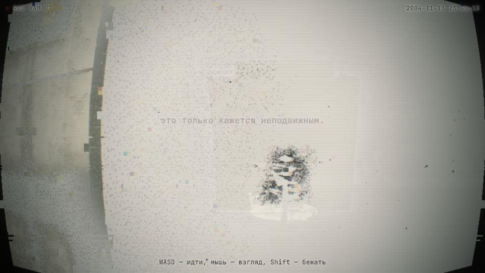
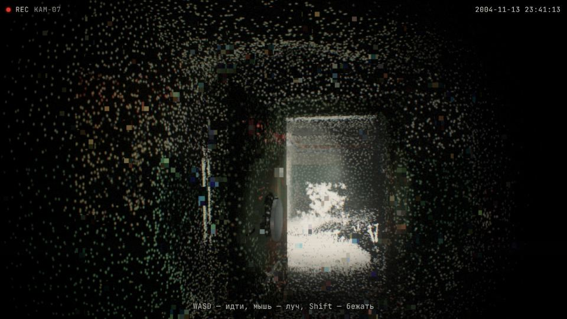

# Untitled Session — Осыпь: проработка

Осыпь — то, что в игре идёт за игроком (в коде — `swarm`). Раньше о ней было написано в трёх местах:
`design.md`, §10 и §15; `untitled_session.md`, раздел о сущности; `story.md`, §6. Этот документ сводит
её в одно место и добавляет то, чего не было, — что она такое в светлом воспоминании.

## 1. Что сказал партнёр

- 15.11, раньше: «Монстр это тревога внутри и сожаление игрока. Когда он появляется, все начинает
  прорастать грибами вокруг. Помимо этого, грибы могут появляться в углах как знак пребывания монстра
  в мире или приближение».
- 15.11, вечер: «Нужно еще детальнее проработать монстра, в зале ожидания сделать его не белого цвета,
  а черного, то есть наоборот инвертированным. Поглощает темнота в светлых воспоминаниях и в темных,
  наоборот, это яркий свет, который тебя разъедает.»

Всё, что ниже названо «предложение» или «решение основной модели», — не слова партнёра.

## 2. Одно правило: она — негатив места

Место в игре держится светом. Значит, то, что его разрушает, — противоположность того света, каким
оно держится. В тёмном воспоминании мир собирает луч фонаря, и угроза там — свет, которого слишком
много: он не освещает, а выжигает. В светлом воспоминании мир собран сам, и угроза — темнота, которая
его съедает. Прежняя формула «она и есть то, что остаётся в темноте» этим отменена: в темноте она
теперь самое яркое, что есть.

| Место | Чем держится | Что она | Как выглядит | Что делает с местом | Чем её держат | Как ловит |
|---|---|---|---|---|---|---|
| Убежище | луч фонаря | свет | белый жар: точки светятся сами | рядом с ней стены белеют и рассыпаются в точки | лучом: он её пересвечивает, и она выгорает | кадр выгорает добела |
| Жёлтые комнаты | луч фонаря | свет | то же | то же | лучом | добела |
| Офис | свет потолка | темнота | чёрные точки; вокруг неё гаснут панели | свет рядом пропадает, место рассыпается | взглядом | кадр тонет в черноте |
| Зал ожидания | неподвижность | темнота | чёрные точки на светлом зале | дневной свет рядом пропадает | взглядом — и только на ходу | в черноте |

Какое место светлое, записано одной строкой на мир (`game.ts`, `POLAR`). Полярность — свойство места,
а не света там, где она стоит: она сама гасит свет вокруг себя и на каждом пороге мигала бы. Офис
записан светлым — это решение основной модели: партнёр назвал только зал ожидания.

## 3. Что сделано в игре

- **Вид.** В тёмном месте её точки — белый жар: светятся сами, ярче фонаря, и там, где их много, сливаются
  в белое; краски мест, с которых она осыпалась (охра, зелёная краска, ржавчина), видны только под
  лучом. В светлом месте точки чёрные, крупнее и плотнее: не светятся и света не берут — дыра в кадре
  (`render/shaders.ts`, `ENTITY_VERT`, `uPolar`).
- **Место вокруг неё.** В радиусе трёх с половиной метров от середины её тела место перестаёт держаться.
  В светлом воспоминании свет рядом с ней пропадает, в тёмном поверхности белеют — и там и там число
  замеров падает, то есть стены и пол рассыпаются в точки (`WORLD_FRAG`, `voidTouch`). Она не освещает
  комнату: её свет ничего не собирает.
- **Поимка.** Раньше кадр гас одинаково. Теперь в тёмном месте он выгорает добела, в светлом тонет
  в черноте. Что теряется, не изменилось: игрок просыпается в начале, найденное остаётся найденным,
  место стирается чуть сильнее.
- **Удержание.** В убежище и жёлтых комнатах всё как было, поменялся только смысл: луч её не «держит»,
  а пересвечивает — полторы секунды луча, и она выгорает и рассыпается. В офисе и зале ожидания фонаря
  нет, и до этой пачки её там нельзя было сдержать ничем. Теперь её держит взгляд: пока она в середине
  взгляда и не за стеной, она стоит, а продержишь — рассыплется. В зале ожидания взгляд стоящего
  не считается: он смотрит на снимок, то есть на то, где она была. Держать её там можно только на ходу —
  идти и не отводить глаз. Подсказка говорит это словами один раз (`teach.swarm.gaze`, `teach.swarm.walk`).

*Зал ожидания: чёрная россыпь на светлой стене.*

*Убежище: белый жар в дверном проёме.*

Проверено по кадрам в трёх мирах: в зале — чёрная россыпь на светлой стене, в убежище — белый жар
в дверном проёме, в офисе её саму не видно: она — зона, где погас свет. Руками не пройдено.

## 4. Что в ней остаётся прежним

- Она сделана из того, что игрок стёр: чем больше касаний и чем больше вспомнено, тем она выше и
  определённее (`game.ts`, рост тела). Это и есть «тревога и сожаление».
- Грибы: в углах — знак, что она рядом; на полу вокруг неё — когда она собрана (`systems/spores.ts`).
- Призрак: если она за спиной, впереди проступает её отражение — красное, в строках развёртки. Красное —
  язык системы, полярность его не касается.
- Она не убивает. Поймала — проснулся в начале.

## 5. Чего ей не хватает (предложения, в игре нет)

От дешёвого к дорогому.

1. **Звук поимки по полярности.** Сейчас один на всё: песок накрывает микрофон. Выжигание — нарастающий
   шип до тишины; поглощение — провал в глухой низ. Два клипа через ElevenLabs.
2. **Свет из-за угла.** В тёмном месте её должно быть видно раньше, чем её саму: белая полоса под
   дверью, отсвет на стене за поворотом. Это честнее грибов говорит «она там» и ничего не стоит —
   одно пятно, прибавленное к кадру.
3. **След.** Где она прошла, место ещё несколько секунд не держится: в тёмном — белёсая выгоревшая
   полоса, в светлом — тёмная. По следу видно, откуда она пришла и куда ушла, когда рассыпалась.
4. **Птицы её чуют.** В зале ожидания голуби срываются с затяжек над тем местом, где она идёт. Игрок
   смотрит не на неё, а под крышу — и понимает, где она. Нужна стая, которая умеет пугаться (сейчас
   она — чистая функция времени).
5. **Своя форма у каждого места.** Сейчас форма одна — столб из прядей. В `story.md`, §6, их шесть;
   следующей там предложена грибница. Откладывается до четырёх полных локаций.

Отсеяно: её свет как настоящий источник, который освещает стены (телефон не потянет, и монстр
превратился бы в лампу); полярность по клеткам; «разъедает» как урон — здоровья в игре нет.

## 6. Что спорно

- **Офис.** Чёрное в зоне, где она сама погасила свет, не видно: игрок видит не фигуру, а темноту,
  которая идёт по этажу. По-моему, так страшнее, и это буквально «поглощает темнота». Но держать
  взглядом то, чего не видно, труднее — возможно, ей нужен контур.
- **Правило «собрано только там, куда смотрит герой».** Чёрная Осыпь — единственное место во взгляде,
  которое не собирается. Это исключение нарочное и должно остаться единственным.
- **Белое уже занято.** Выбеливанием кадра показан скачок между местами. Поимка в тёмном месте теперь
  тоже белая; отличается она тем, что белое приходит с её стороны и перед ним — рывок линзы. Если
  на практике их путают, поимке нужен свой оттенок.

## 7. Вопросы партнёру

Собраны в общий список — `plan.md`, §5.
