# Untitled Session — дешёвые визуальные трюки: что есть, что взять, что не брать

Слова партнёра (15.11): «Собери еще блок реалистичных и не затратные интересных визуальных трюков
с помощью three js и webgl в отдельный файл с примерами, картинками и ссылками если такие есть».
Рядом: «Еще думаю добавить птиц, пока не понимаю куда и как» — и два присланных материала: текст про
волосы и мех в three.js и справочник из шестнадцати общих приёмов («Посмотри, вдруг что-то
пригодится»).

После разбора партнёр ответил: «Добавляй все по эффектам и птиц» (15.11, вечер). Что из списка
сделано, чем и что осталось ждать — помечено у каждого приёма в §2 и в §3.

Это не ещё один каталог, а сортировка под нашу игру: что уже работает (с нашими кадрами), что стоит
взять первым и зачем, что не брать. Полный список из тридцати трёх приёмов со ссылками собрал
помощник поиском — `_research/tricks_sources.md`; страницы оттуда не открывались, ссылки взяты
из выдачи. Всё, что ниже названо «мнение» или «предложение», — основной модели.

## 0. Три ограничения, о которые ломается половина чужих трюков

1. **Прозрачность у нас занята.** Четвёртый канал кадра хранит не прозрачность, а «число замеров» —
   насколько место собрано (по нему потом решается, показать поверхность или точки). Любой типовой
   трюк со смешением — стекло, мягкие частицы, лучи-конусы — в лоб не вставить. Годится то, что
   рисуется сплошным, прибавлением (как пыль и звёзды) или растром вместо прозрачности. *Поправка
   15.11: годится и настоящее смешение, если оно смешивает только цвет, а четвёртый канал оставляет
   как был, — так сделано стекло крыши (§2, приём 14).*
2. **Телефон видит самую бедную картинку.** На низком качестве нет теней, дымки и второй выборки
   фактуры. Трюк, которому нужен лишний проход по всему кадру, на телефоне не включится.
3. **Собрано только там, куда смотрит герой.** Украшать то, что вне взгляда, незачем: его не видно.
   Зато всё, что вне взгляда, можно менять — это главный и бесплатный трюк игры (`cinema.md`).

## 1. Что уже работает в игре

| Приём | Что даёт | Чего стоит |
|---|---|---|
| Мир из точек и конус взгляда | место собирается там, куда смотришь, остальное — россыпь | один проход точек поверх кадра |
| Память света | там, куда смотрел только что, ещё висят точки и осыпаются | ещё одна текстура на кадр |
| Один материал на matcap-шарах | бетон, краска, ржавчина, эмаль — одним шейдером, одним вызовом на помещение | почти ничего |
| Тень одной картой | тень фонаря в убежище, тень солнца и переплёта крыши в зале ожидания | один проход глубины; на низком качестве выключена |
| Распад в зёрна | тронутая вещь осыпается точками своего цвета и собирается обратно | хеш в шейдере, без прозрачности |
| Красная сетка | светится сама: знак «место сбоит» — на полу перед провалом, на потолке, который опускается | несколько строк в шейдере |
| Сдвиг вершин | потолок провисает, как брюхо; мир рассыпается при скачке | ничего |
| Звёздное небо с глубиной | ближние звёзды смещаются относительно дальних, когда идёшь; падающие звёзды | один вызов, 5,7 тысячи точек |
| Длинная выдержка | в темноте всё яркое оставляет след при повороте головы | один проход, только без света |
| Линза | бочка, хроматическая аберрация, рывок в миг пробуждения, сжатие под потолком | в общем пост-проходе |
| Дымка в луче | луч фонаря виден в воздухе | проход в половинном буфере; на низком выключена |
| Картинки на стенах | плакаты, карточки, экраны, проекции — из одного атласа | ничего |
| Фактура без повторов | координаты карты грязи уводит волна, подмешана вторая выборка | одна лишняя выборка на среднем и высоком |

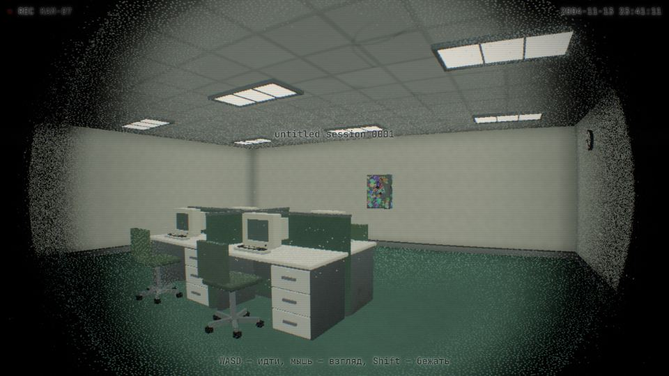

*Офис. Собрано только там, куда смотрит герой; по краям кадра — россыпь точек.*

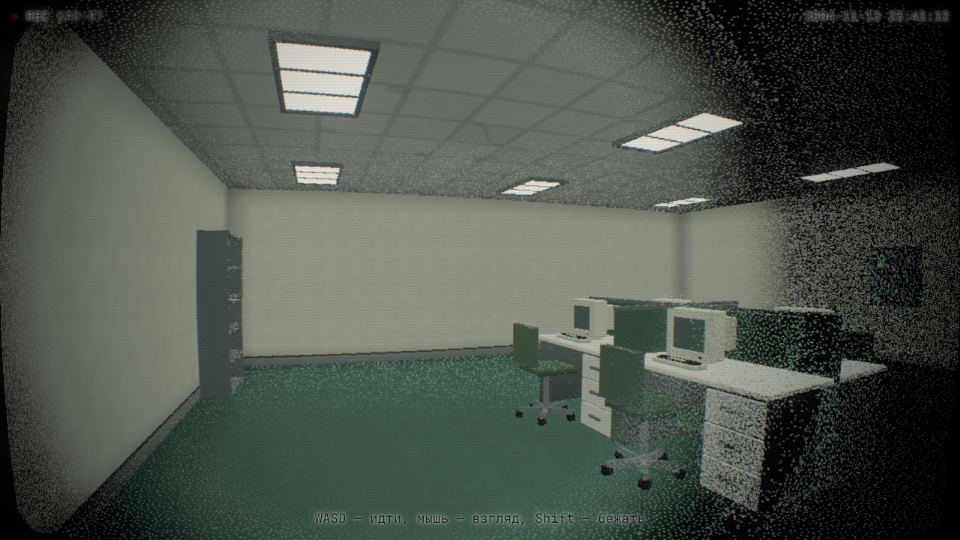

*Память света: повернул голову — там, куда смотрел, место ещё держится точками.*

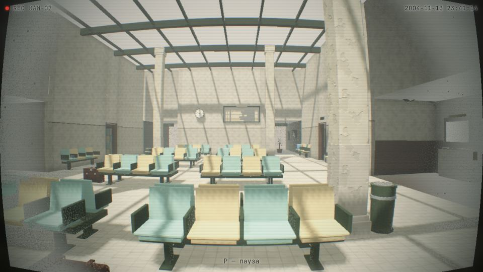

*Зал ожидания. Тень переплёта стеклянной крыши — одна карта теней на весь уровень; по ней видно, как идёт время.*

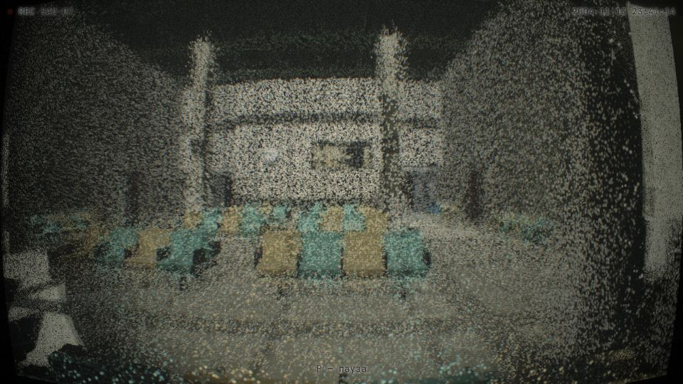

*Тень поезда: света на три секунды нет — и зал стоит одними точками.*

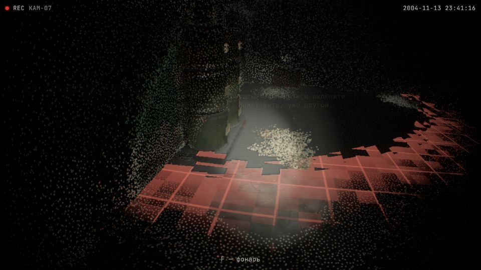

*Провал: пол рассыпается кругом, кромка рваная. Ни прозрачности, ни частиц — отбрасывание пикселей по хешу.*

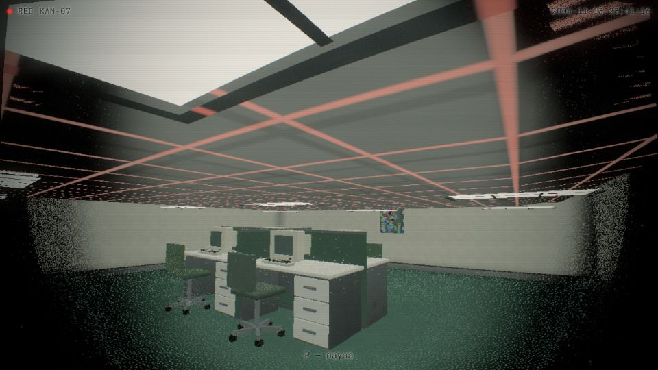

*Сжатие: потолок провисает сдвигом вершин; лампы едут вместе с ним.*

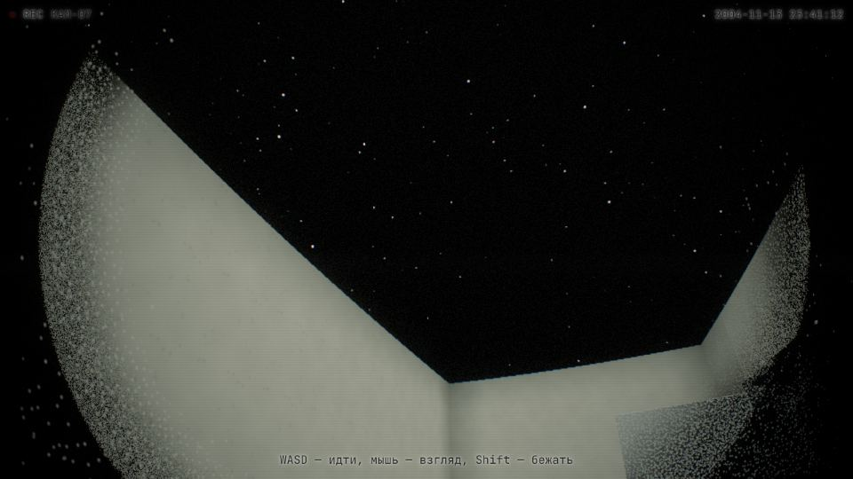

*Комната без потолка. Звёзды — точки в мире, а не картинка на куполе.*

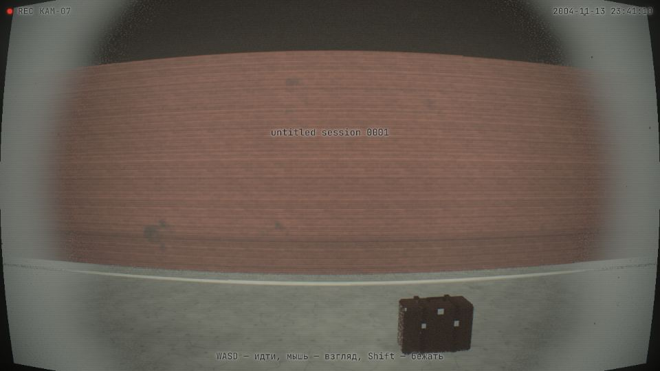

*Длинная стена после правок: ни тёмных полос каждые три метра, ни рядов одинаковых пятен.*

## 2. Что взять первым

По пользе именно для этой игры; первые пять — дёшевы и ладят с нашей сборкой кадра. Из четырнадцати
приёмов одиннадцать сделаны 15.11 вечером, один оказался не нужен, два ждут своего дела.

1. **Тень переплёта без карты теней.** В зале ожидания время видно по теням крыши, а на телефоне
   теней нет вовсе — главное ощущение места там пропадает. Балки крыши стоят ровной решёткой,
   поэтому их тень можно посчитать прямо в шейдере: луч от точки пола к солнцу пересекает плоскость
   крыши — попал в балку или нет. Ни одного лишнего прохода. В кино и играх это называют gobo или
   light cookie: тень как узор, а не как расчёт. (В three.js `SpotLight.map` работает только вместе
   с тенями, поэтому считать надо самим.)
   **Сделано:** `roofShade` в шейдере мира. На низком качестве это единственная тень зала; на среднем
   и высоком формула продолжает карту теней там, куда та не достаёт, — решётка лежит через весь зал.
   Ссылки: [SpotLight](https://threejs.org/docs/api/en/lights/SpotLight.html),
   [обсуждение на форуме](https://discourse.threejs.org/t/what-does-the-textures-map-do-for-a-spotlight-and-do-i-need-one/44357/4.md).
2. **Свечение на просвет.** Бумажный цветок и шляпка гриба светятся, когда свет за ними: бумагу от
   пластика отличает именно это. Одна строка в шейдере, работает на низком качестве, прозрачность
   не нужна. Из справочника партнёра, приём 16.
   **Сделано:** у материала появилось свойство «просвет» (бумага — 0,55). Светится от солнца за
   листом, от отсвета стены позади и от потолка — если смотреть на лепесток снизу. Оговорка: фонарь
   всегда у глаз, поэтому прямо от него просвета почти не бывает; заметнее всего это в светлых местах.
   Ссылка: [пример three.js](https://threejs.org/examples/webgl_materials_subsurface_scattering.html).
3. **Ветер в вершинах и ленты.** Одна функция для всего, что висит: подвесные цветы, бельё поперёк
   переулка, перья. Корень неподвижен, конец качается с запозданием. Из текста про волосы партнёру
   здесь годится главное — не считать каждую прядь, а двигать немного управляющих точек и гнуть по
   ним ленты.
   **Сделано:** у вершины есть вес качания (закреплённый конец стоит, свободный ходит и запаздывает).
   Качаются бумажные цветы, оборванные кабели, светильник на одной цепи, люстра, указатель, бумажные
   птицы и трава луга. У каждого мира своя сила ветра; в зале ожидания поезд гонит воздух — всё
   висящее качается втрое сильнее, а на снимке ветер стоит.
   Ссылки: [трава с ветром](https://al-ro.github.io/projects/grass),
   [приём «сила ветра в цвете вершин»](https://docs.godotengine.org/en/3.4/tutorials/shaders/making_trees.html).
4. **Ложная комната за окном (interior mapping).** За стеклом видна комната с глубиной, хотя
   геометрии нет: один шейдер пересекает луч взгляда с воображаемым ящиком. Нам это даёт обманку
   зала ожидания, которой пока нет: окно кассы, за которым тот же зал.
   **Сделано:** за окошком кассы — зал под стеклянной крышей с четырьмя столбами и двумя проёмами,
   пустой и в вечернем свете, какое бы время ни стояло в настоящем зале (`fakeHall`). Геометрии
   за стеклом нет.
   Ссылки: [разбор для three.js](https://kristian-dixon.github.io//2025/02/27/InteriorMapping.html),
   [three-fenestra, MIT](https://www.jsdelivr.com/package/npm/three-fenestra),
   [исходная статья](https://gamedeveloper.com/programming/interior-mapping-rendering-real-rooms-without-geometry).
5. **Шестиугольная укладка фактуры (hex tiling).** Настоящее лекарство от повтора: каждая
   шестиугольная ячейка берёт фактуру со своим сдвигом, три соседние смешиваются. Три выборки вместо
   одной. Годится для штукатурки, бетона, земли; кирпичу, плитке и паркету не годится — у них
   повтор и есть рисунок.
   **Сделано** на высоком качестве (`hexDetail`). Телефон начинает со среднего и этого не увидит.
   Заодно пересчитана сама карта грязи: её пятна были ромбами по осям решётки шума (§2а).
   Ссылки: [статья Миккельсена](https://jcgt.org/published/0011/03/05/paper.pdf),
   [демо автора](https://github.com/mmikk/hextile-demo),
   [порт, читается как псевдокод](https://godotshaders.com/shader/stochastic-hex-tiling-mikkelsens-adaptation/).
6. **Растр вместо прозрачности (ordered dither).** Стекло, дым, полупрозрачная ткань — шахматным
   выбиванием пикселей. Единственный способ «прозрачности», который не спорит с нашим четвёртым
   каналом, и он в родстве с картинкой из точек. Считать в пикселях внутреннего буфера.
   **Не понадобился:** стекло сделано настоящим смешением, которое не трогает четвёртый канал. Растр
   остаётся в запасе для дыма и ткани.
   Ссылки: [разбор на Codrops](https://tympanus.net/codrops/2025/06/04/building-a-real-time-dithering-shader/),
   [статья Максима Хекеля](https://blog.maximeheckel.com/posts/the-art-of-dithering-and-retro-shading-web).
7. **Тень-пятно и ложный конус луча на низком качестве.** Без теней вещи висят над полом. Тёмное
   пятно под мебелью и конус-призрак вместо дымки возвращают телефону то, что отняла экономия.
   Из справочника партнёра, приёмы 1 и 9.
   **Сделано.** Тень-пятно — не только для телефона: карта «сверху» запекается при сборке уровня
   (`world/contact.ts`), пол под мебелью темнее на любом качестве; вещь рассыпалась — пятно ушло.
   Конус луча — на низком качестве, одной формулой в общем проходе.
   Ссылка: [контактная тень, пример three.js](https://threejs.org/examples/webgl_shadow_contact.html).
8. **Объём для точек (eye-dome lighting).** Точки без нормалей получают край и глубину одним
   проходом по карте глубины: дальнее вокруг ближнего темнеет. Придумано для сканов — ровно наш
   случай. Готового пакета нет, шейдер придётся перенести.
   **Сделано** на высоком качестве: четыре выборки глубины на точку. Эффект тонкий; на телефоне нет.
   Ссылки: [описание](https://fsl.dev/docs/features/edl/),
   [обсуждение переноса](https://forum.babylonjs.com/t/eye-dome-lighting-edl-for-point-clouds/21737).
9. **Разрыв кадра (datamosh).** Сейчас разрыв снимка в зале ожидания — помеха из блоков. Настоящий
   датамош тянет прошлый кадр по движению нового: то, что было, размазывается по тому, что есть.
   По смыслу это и есть «снимок разошёлся с местом».
   **Сделано:** блоки по шестнадцать точек держат прошлый кадр и тянут его за камерой; чем дольше
   стоял снимок, тем их больше. Гаснет за полсекунды.
   Ссылка: [разбор на Codrops](https://tympanus.net/codrops/2026/09/02/breaking-the-frame-building-a-real-time-datamosh-effect-with-three-js/).
10. **Точки, которые собираются в модель.** Нужны мета-слою (`meta.md`): путь игрока перетекает
    в вещь. У нас вещи уже рассыпаются в зёрна — осталось научить зёрна лететь к чужой форме.
    **Ждёт мета-слоя:** без него приёму негде жить.
    Ссылка: [морф между облаками точек](https://discourse.threejs.org/t/morphing-between-geometries-of-points-system-on-gpu/37688).
11. **Картинка, которая складывается с одной точки (анаморфоза).** Тоже для мета-слоя и для
    обманок: надпись или силуэт, разбросанные по комнате, читаются только с порога.
    **Ждёт мета-слоя** и решения, что именно должно складываться.
    Ссылка: [The Sweet Spot](https://www-artificialnoodles-com.pages.dev/blog/the-sweet-spot).
12. **Мох и мех слоями (shell texturing).** Для зарослей: поверхность повторяется несколько раз
    с выдвижением наружу. Дорого по площади пикселей — только на небольших вещах и только в луче.
    **Сделано:** кочки мха у воды в убежище, девять слоёв (`world/moss.ts`). Первое из «зарослей».
    Ссылки: [mate-h/shell-texturing](https://awesome.ecosyste.ms/projects/github.com%2Fmate-h%2Fshell-texturing),
    [исходная работа](https://people.csail.mit.edu/ericchan/bib/pdf/p227-lengyel.pdf).
13. **Порталы.** Швы между местами (`pressure.md`, §4) без затемнения: в проёме видно другое место.
    Самое дорогое в списке — место за порталом рисуется второй раз. Сначала попробовать дешёвый
    вариант: перенос на пороге, пока порог вне взгляда.
    **Ждёт швов между местами** — по ним партнёр ещё не ответил (`plan.md`, §5, вопросы 2 и 3).
    Ссылки: [порталы в three.js](https://dev.to/viridia/creating-portals-in-three-js-2dbm),
    [через трафарет](https://discourse.threejs.org/t/portal-rendering-with-stencil-buffer/22425).
14. **Тонкое стекло для крыши зала.** Сейчас крыши как бы нет — только переплёт. Смешивать нельзя
    (ограничение 1), но можно дать стеклу блик: прибавить отсвет неба под скользящим углом.
    Из справочника партнёра, приём 14.
    **Сделано:** лист стекла над переплётом — пыль и потёки (гуще у балок), белёсая пелена под
    скользящим углом и само солнце с ореолом. Смешивается с кадром только цветом.

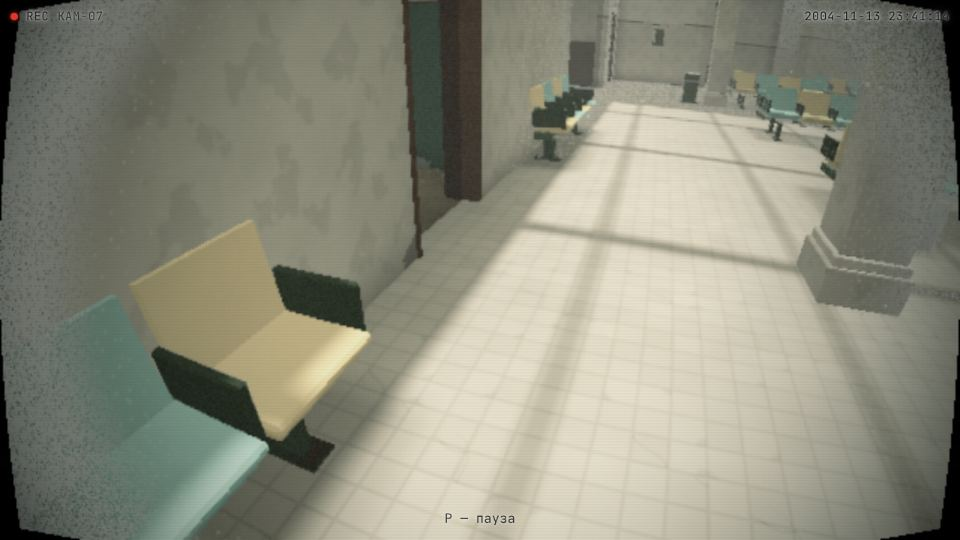

*Зал ожидания на низком качестве: карты теней здесь нет, решётка теней посчитана по формуле.*

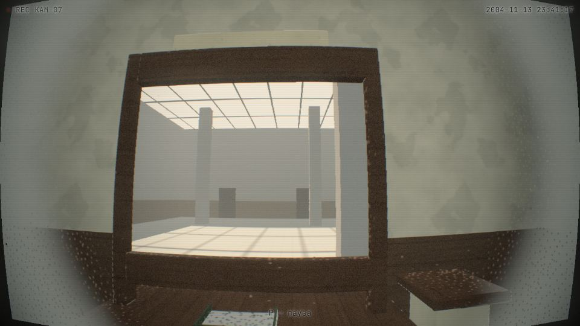

*Окошко кассы. За стеклом нет геометрии: зал со столбами и переплётом посчитан по лучу взгляда.*

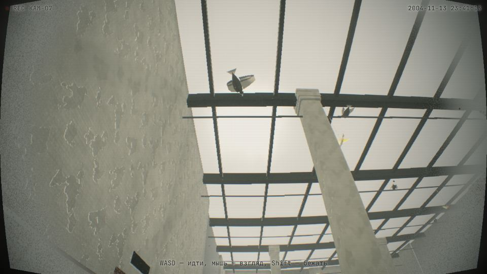

*Стекло над переплётом: пыль гуще у балок, солнце с ореолом; на затяжках сидят голуби.*

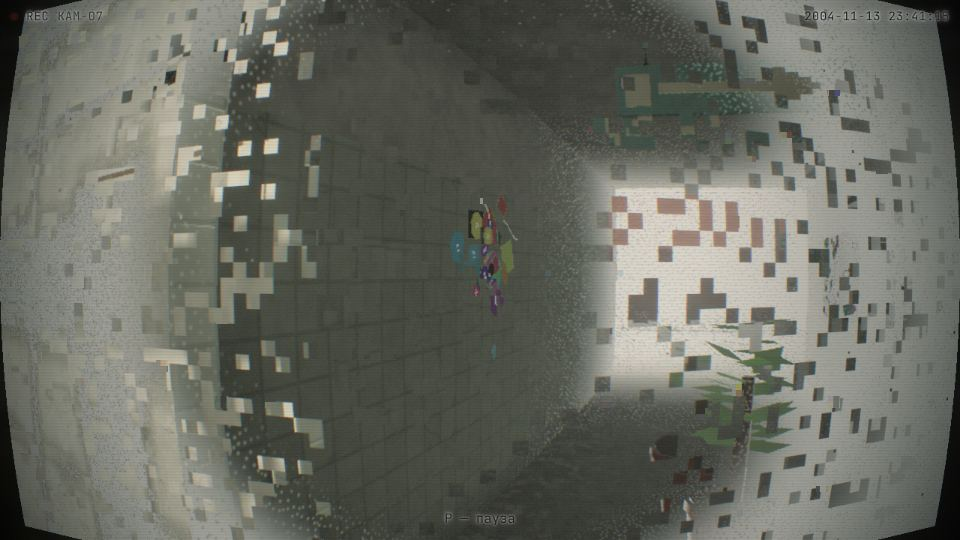

*Разрыв снимка: блоки прошлого кадра ещё держатся и едут за камерой.*

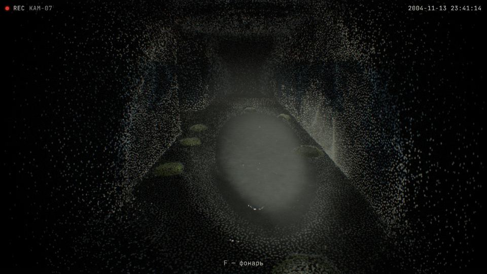

*Мох слоями: кочки у воды в убежище.*

## 2а. Что сделано сверх списка

- **Блики ряби** (справочник партнёра, приём 8): когда луч лежит на воде, отсвет на стенах вокруг идёт
  сетью бегущих светлых линий.
- **Карта грязи.** Партнёр прислал без слов снимок: кирпичная стена в луче, вся в тёмных угловатых
  пятнах. Причина — шум, которым считалась карта: у него пятна выходят ромбами по осям решётки. Карта
  пересчитана градиентным шумом, уведённым в стороны; доля тёмного и светлого оставлена прежней.
  Плесень теперь к краю редеет на пятнышки, сырость держится у пола, сырой кирпич остаётся кирпичом,
  облезлость ложится участками, а не ровной россыпью.

## 3. Птицы

Партнёр: «думаю добавить птиц, пока не понимаю куда и как». Моё мнение — ниже; после него партнёр
написал «Добавляй… птиц».

**Что сделано (15.11, вечер).** В зале ожидания под крышей натянуты затяжки — тонкие стальные прутья
под каждой балкой; на них сидят шесть голубей. У каждого расписание «сидит — летит — сидит» от сида,
и стая — чистая функция времени места: идёшь — перелетают, встал — висят в воздухе, шагнул — они уже
на других местах. Один голубь ходит по полу: подойдёшь ближе трёх с половиной метров — взлетит под
крышу и останется там. В убежище, офисе и жёлтых комнатах — одна птица на кромке стены в комнате под
звёздным небом: подойдёшь или посветишь на неё секунду — улетит вверх и не вернётся. Следы: четыре
пера на полу зала, три бумажные птицы на нитках под затяжками, хлопок крыльев и воркование. Круг
за кругом птиц меньше. Тел у птиц одна сетка на всех, крыльями машет шейдер. Чего нет: помёта, птиц,
которые пугаются поезда и Осыпи, перьев в комнате под небом.

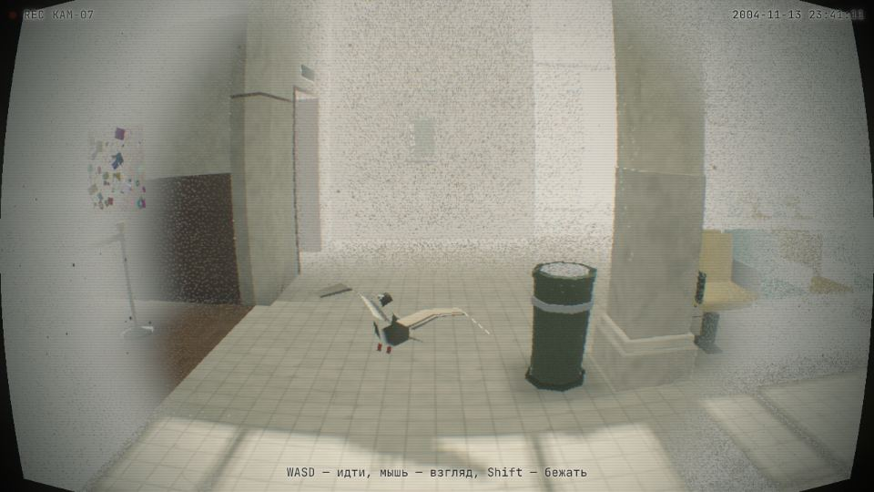

*Голубь на полу зала: подошли ближе трёх с половиной метров — взлетел.*

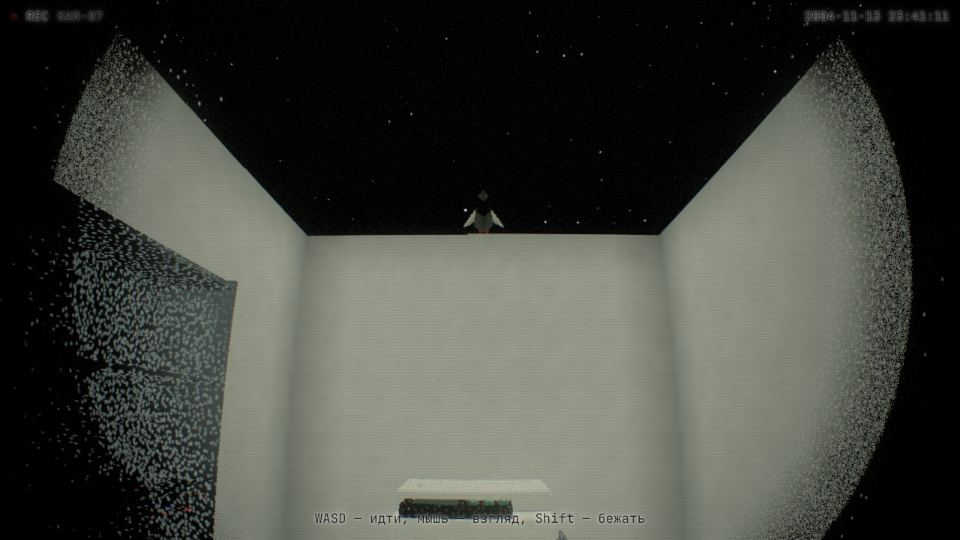

*Комната под небом в офисе: птица на кромке стены.*

**Куда.** В зал ожидания. Голуби под стеклянной крышей вокзала понятны в любой стране, и это
единственное место, где птица не украшение, а объяснение закона. Стоишь — видишь снимок: птица
висит в воздухе с раскрытыми крыльями. Шагнул — снимок рвётся, и она уже на другой балке, потому что
под снимком время шло. Закон места становится понятен без слов за одну секунду. Второе место —
комната под звёздным небом: одна птица на кромке стены, которая улетает вверх и не возвращается.

**Как.** Не стаей и не из точек: плотный клубок точек у нас уже есть, это Осыпь, и путать их нельзя.
Пять-семь крупных птиц, каждая — две ленты-крыла со взмахом в вершинном шейдере на одном
инстансированном меше. Никакой симуляции стаи: у каждой свой маршрут между балками по времени места.
Это самый дешёвый способ из найденных — силуэты в один вызов.

**Сначала — следы.** Перо на полу, помёт на балке, хлопок крыльев за спиной. Это почти ничего
не стоит и сразу покажет, нужны ли тела. И это честно по правилу «людей нет, только следы»: птица —
первое живое в игре, и вводить её стоит осторожно.

**Со стиранием.** Круг за кругом птиц меньше; потом под крышей висят бумажные птицы на нитках
(родня бумажным цветам); в конце остаются перья.

Ссылки: [стая на одном инстансированном меше](https://danieljohnmorris.com/writing/threejs-boids-flocking/),
[официальный пример со стаей на видеокарте — как устроен](https://discourse.threejs.org/t/gpu-birds-example-changing-shape/3172)
(на телефонах он ненадёжен: [формат текстур сбоит](https://discourse.threejs.org/t/gpgpu-birds-example-using-half-float-to-store-position/6190.md)).

## 4. Волосы и мех: что годится из присланного текста

Персонажей с волосами у нас нет, поэтому сам рецепт (ленты с текстурой волос, физика на
шести–двадцати управляющих прядях, шейдер с вытянутым бликом) в лоб не нужен. Нужны из него три
вещи:

- **принцип** — не считать каждую прядь, а двигать немного точек и гнуть по ним ленты: так делаются
  перья, бельё, подвесные цветы (§2, приём 3);
- **слои для короткого меха** — то же, что мох для зарослей (§2, приём 12);
- **вырезание вместо прозрачности** (`alphaTest`) — ровно наше ограничение 1.

Осыпь уже сделана близко к этому: сотня прядей из точек с головой и направлением.

## 5. Справочник партнёра: шестнадцать приёмов против нашей игры

| № | Приём | У нас | Что делать |
|---|---|---|---|
| 1 | Тень-пятно | сделано | на любом качестве (§2, 7) |
| 2 | Запечённый свет и затенение | затенение в вершинах есть | свет не печь: уровни собираются на ходу |
| 3 | Matcap | есть, на нём весь мир | — |
| 4 | Мелкий рельеф | есть: рельеф считается по фактуре | — |
| 5 | Свет по краю (френель) | сделано в стекле крыши | — |
| 6 | Статичная карта окружения | не нужна: отражения даёт matcap | не брать |
| 7 | Декали проекцией | есть: плакаты, надписи, наклейки из атласа | — |
| 8 | Ложные блики воды | сделано: рябь отсвета на стенах | — |
| 9 | Ложные лучи | есть: дымка в луче; на низком — конус-призрак | — |
| 10 | Трава инстансами и ветер | трава на лугу есть, ветер сделан | — |
| 11 | Мягкие частицы | есть: пыль в луче, прибавлением | — |
| 12 | Туман по глубине | есть | — |
| 13 | Растворение по хешу | есть: распад мира и вещей | — |
| 14 | Тонкое стекло | сделано: крыша зала | — |
| 15 | Плоские двойники деревьев | нет | не брать: плоская вещь у нас значит «ложная» |
| 16 | Свечение на просвет | сделано: бумага | — |

Из шестнадцати тринадцать теперь работают, три не нужны.

## 6. Чего не брать

- **Гауссовы сплаты и объёмные облака** — для телефона дорого; сплаты ещё и спорят с нашей картинкой
  из точек, которую мы собираем сами.
- **Отражения отдельным проходом** (зеркальный пол) — место рисуется второй раз ради одного блика;
  мокрый пол у нас уже отражает пятно света дешёвым способом.
- **Свежие примеры three.js на WebGPU и TSL** (лучи, CRT, птицы на вычислительных шейдерах) — наш
  рендер на WebGL2; они годятся только чтобы сверить математику.
- **Плоские двойники, запечённый свет, карты окружения** — см. таблицу выше.

## 7. Источники

- `_research/tricks_sources.md` — тридцать три приёма и блок про птиц со ссылками; собрано поиском,
  страницы не открывались, лицензии указаны только там, где были видны в выдаче.
- Справочник партнёра «Visual Shortcuts» — шестнадцать приёмов; ссылки из него ведут на официальные
  примеры и документацию three.js.
- `cinema.md` — приёмы кино по деконструкции пространства и что из них взять.
